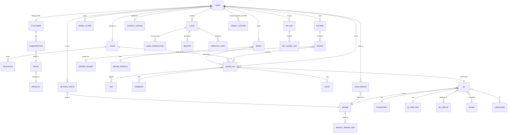
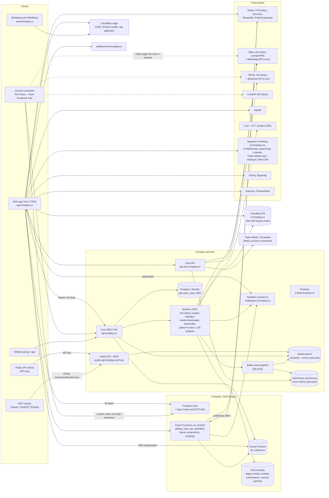

# Foreplay — Technical & Product Teardown and Build Plan

**Subject:** Foreplay (app.foreplay.co, www.foreplay.co) — ad-creative research SaaS
**Date:** 24 Oct 2026 (IST)
**Prepared for:** your own competitive build (observe-only analysis)

## How this was produced

- **Live browser (REA over CDP, `127.0.0.1:9222`).** Seven page targets were analysed: the app at API & MCP, Discovery, Swipe File, Spyder, Lens and Briefs, plus the marketing homepage. For each, REA ran page inspection (accessibility text, JSON body shapes, storage-key inventory with values redacted by REA), bundle analysis with source-map fetching, WebMCP discovery, and script export. A screenshot was captured for `/api-overview`.
- **Static code analysis** of 17 exported scripts (digest-verified): `analyze_javascript_application`, `trace_web_module_imports`, `trace_javascript_semantics`, plus identifier and string analysis that printed counts, hostnames and identifiers only, never code.
- **Public sources.** Foreplay pricing, help center, published OpenAPI spec, changelog, careers page, Chrome Web Store and app-store listings, and official ad-library documentation. Gathered by two research passes with WebSearch/WebFetch.
- **Not used:** the Foreplay MCP (per your instruction); any Foreplay internal API call; replayed requests; authentication or paywall bypass.

## Conventions

- **OBS** = OBSERVED, with an REA evidence label (E01–E29, S1) or a public URL (A.3).
- **INF** = INFERRED, with the reasoning stated.
- **UNK** = UNKNOWN.
- Confidence is **H / M / L**.
- Evidence labels map to full REA evidence IDs in the Appendix.
- No secrets or personal data are reproduced: no API key, tokens, cookies, emails or client SDK keys. Auth is described by type only.
- No proprietary code is reproduced; behaviour is described in prose.

## Limitations up front

- **No HAR files.** `foreplay-re/har/` did not exist at any of four checks, and passive observation windows recorded zero requests. Request/response shapes therefore come from code and the public OpenAPI spec, not traffic. The upgrade path is in Phase 10 (G1).
- **No Launchpad tab** was open, so that module is covered from code only.
- **7 of 11 source maps** were too large for REA's decoder.
- **`recover_javascript_sources` failed**: it needs a Wakaru Linux x64 binary.
- **The REA connection to your Mac dropped** near the end of the session, after all evidence had been exported to `foreplay-re/rea-session/`.

---
## Phase 1 — Executive summary

### What Foreplay is

Foreplay is a workflow tool for paid-social creative teams. It covers the loop **find → save → organise → analyse → brief**:

- **Save.** Ads are saved from ad libraries and social feeds with a Chrome extension and mobile apps.
- **Swipe File.** Saved ads are organised into boards and folders, with automatic transcription and AI tagging.
- **Discovery.** A community-sourced, searchable ad library.
- **Spyder.** Monitors competitors' Meta ads around the clock, with longevity and velocity rankings.
- **Lens.** Analyses the customer's own Meta/TikTok creative performance.
- **Briefs.** Turns inspiration into AI-assisted briefs and scripts.
- **API & MCP.** Since 2025–26 everything is also exposed through a credit-metered public API and an MCP server, so Claude, ChatGPT and other agents can use the data.

All modules are OBS: E19–E23, E02 and the public pages in A.3.

### Target users

- Performance marketers, creative strategists, media buyers, UGC/creative agencies and DTC/e-commerce brands.
- Industry pages also target mobile apps/gaming, B2B/SaaS, info/education and freelancers (www navigation, E15).
- Named customers: AG1, Dr. Squatch, Rhode (careers page); Lululemon and Paramount in 2024 press.

### Core value

1. **Never lose an ad.** A permanent copy survives the ad being taken down from the library.
2. **Search across a large shared corpus.** Public claims range from 54.7M (live counter) to "200M+"; see G17.
3. **Automated competitor tracking.**
4. **Creative analytics** that link "what competitors do" with "what works for us".
5. **Briefing and collaboration** in one place.
6. **Agent access** via API and MCP.

### Business model and pricing (public, Oct 2026)

| Plan | Monthly | Annual (per month) | Seats | Notable inclusions |
|---|---|---|---|---|
| Basic | $59 | $49 | 1 | Swipe File, Discovery, Briefs |
| Workflow | $175 | $149 | 5 | + Spyder (15 brands; unlimited on annual), Lens (1 brand), AI-tool connection (MCP/API) |
| Agency | $459 | $389 | 10 | Spyder 50 brands, Lens 10 brands |
| Enterprise | custom | custom | unlimited | Unlimited use, Slack support |

- **Add-ons:** extra users $20 each; extra Lens brands $50 each, regardless of ad spend.
- **API credits:** 10k/month on non-legacy plans, 20k/month on annual. Top-ups $99 / $189 / $349 per month for 100k / 250k / 500k credits.
- **Trial:** 7 days, card required on the pricing page (some product pages say "no card"); 14-day money-back guarantee; no free tier.
- **Company:** bootstrapped and profitable. Revenue was "single-digit millions" with about 11 staff in mid-2024, growing 75%+ a year for three years (2026 job post). Founded 2021 by Zach Murray, Toronto, formerly Adison.io; acquired GetSpyder in 2023.

Sources: A.3 (pricing, help, careers, podcast).

### Key takeaways

1. **The stack is pragmatic and Firebase-centric at the edges** (OBS H).
   - Vue 2.7 SPA with Vuex and webpack, Firebase Auth, App Check and Firestore accessed directly from the browser (32 collections), and Cloud Functions for billing and team operations.
   - Separate services for the core API, Lens API, public API/MCP and socket.io notifications.
   - Cloudflare edge and R2 for content-addressed media.
   - The heavy data plane — Kafka, ClickHouse, Elasticsearch, Postgres/MySQL, Node/Python — comes from Foreplay's own job post (OBS public).
2. **Monetisation is layered meters, not just seats** (OBS H). Plan tier + seats + Spyder brand credits + Lens brand slots + API credits, all enforced in the UI with paywall components and pushed live over socket.io.
3. **Spyder and Discovery depend on the Meta Ad Library**, which is now under tighter terms (anti-automation even when logged in, from 2025). Spyder is Meta-only.
   - For your build, the **official DSA repositories** (Meta Ad Library API for EU/UK, TikTok Commercial Content API, Google Transparency Center dataset, Snapchat/Microsoft/X APIs) plus **user-initiated saves** and **first-party OAuth analytics** are the defensible path (§9.4).
4. **Lens outsources Meta account connectivity to Triple Whale's Orcabase** (INF H) and computes percentile-per-dollar scores (Hook, Watch, Click, Convert, Viral). This is a partner dependency you can avoid by using the Marketing API directly.
5. **AI is everywhere but server-side**: automatic transcripts and AI analysis on every saved ad, hooks, AI briefs, AI agency listings, MCP prompts. The job post says the AI is in-house.
6. **Notable weaknesses:**
   - **Publicly served production source maps** (Phase 8, S-1).
   - **End-of-life Vue 2** and Firebase v8.
   - **Heavy client:** ~7 MB of JS on Discovery and ~15 third-party scripts.
   - **Two error monitors** and **two session-replay tools.**
   - **Inconsistent public numbers** (G17).
7. **Market gap you can target:**
   - Cross-network coverage, especially Google/YouTube via the Transparency Center and TikTok via its official API.
   - Reach-aware EU intelligence.
   - Agent-first API/MCP from day one.
   - Regional pricing.

   Competitors span $26/mo (Swipekit) to $999+/mo (Motion), with Foreplay at $49–$389/mo annual.
8. **Infrastructure is cheap relative to revenue.** A comparable product runs at roughly $0.6–1k/month at 100 users, $3–5k at 1,000 and $22–32k at 10,000 (§9.5). AI tagging and search are the cost drivers; dedupe per creative is the key lever.
## Phase 2 — Tech stack

Legend: **OBS** = OBSERVED (evidence label from the Appendix), **INF** = INFERRED (reasoning given), **UNK** = UNKNOWN. Confidence: H / M / L. "S1" refers to string and identifier analysis of the 12 core scripts exported by REA (E10) and the 5 module chunks (E29). Every exported file was digest-verified against REA's capture.

### 2.1 Frontend framework

| Item | Finding | Label | Conf |
|---|---|---|---|
| Framework | Vue 2.7.16 (version string in the vendor chunk). Scoped-style `data-v-*` attributes are on every DOM node. Templates are compiled render functions. | OBS S1, E02 | H |
| Language | JavaScript; `.vue` single-file components plus `.js` utilities (original paths in source maps, e.g. `src/views/auth/LoginView.vue`, `src/utils/lens/formatNumberLabel.js`). No `.ts` paths appear in the four parsed maps. | OBS E08, E26–E28 | M (only 4 of 11 maps parsed) |
| App shell | Single-page app with `MainLayout.vue`, a sidebar (Home, Launchpad %, API & MCP, Starred, Default Folder, Upgrade) and per-module views under `src/views/<module>/`. | OBS E02, E19–E23, E26–E28 | H |
| Code splitting | 112 lazy route chunks are registered in the webpack chunk map; each module tab loads its own chunk (Spyder `chunk-da1112a8`, Lens `chunk-0795581c` + `chunk-63974858`, Briefs `chunk-6f031f28`, Swipe File `chunk-18f9815d`). | OBS S1, E24–E29 | H |

### 2.2 UI layer

| Item | Finding | Label | Conf |
|---|---|---|---|
| Design system | In-house component set (`src/components/globals/Icons/*`, `PaywallCard.vue`, `TutorialModal.vue`, drawer components). | OBS E08 | H |
| Styling | Utility-class tokens (`flex-shrink-0`, `border-t`, design tokens such as `border-border-normal`) suggest Tailwind CSS compiled at build time. No Tailwind runtime string exists, which is expected. | INF (class-name pattern) | M |
| Typeface | Inter (self-hosted `.woff2` in `/fonts/`). | OBS E05 | H |
| Command palette | `ninja-keys` web component (⌘K-style), present in the DOM and bundle. | OBS E02, S1 | H |
| Masonry grid | `vue-stack-grid`, `vue-images-loaded`. | OBS E08 | H |
| Infinite scroll | `vue-infinite-loading`. | OBS E26, E27 | H |
| Charts | ApexCharts (740 references in lazy chunks; used by Lens and Spyder). | OBS E08, S1 | H |
| Rich text | TipTap (`@tiptap/extension-link`, `character-count`); used in ad-drawer notes and briefs. | OBS E08 | H |
| Animation | Lottie (Lottielab CDN). | OBS S1 | H |
| Zip export | JSZip (bulk ad download). | OBS E08, S1 | H |
| Validation | `validationMixin` token, consistent with Vuelidate. | INF (mixin name) | M |
| Tooltips | v-tooltip / tippy tokens in vendor. | INF | M |

### 2.3 State management

| Item | Finding | Label | Conf |
|---|---|---|---|
| Store | Vuex 3.6.2. | OBS S1 | H |
| Realtime → store | Socket.io events (`adCreated`, `subscriptionChanged`, `totalAdsCount`) and plan limits (Spyder, Lens, additional Lens) are committed into Vuex modules. | OBS S1 | H |
| Local persistence | IndexedDB/localStorage are used only by SDKs (Firebase, PostHog, Intercom, etc.). Values were redacted by REA. | OBS E09 | H |

### 2.4 Routing

| Item | Finding | Label | Conf |
|---|---|---|---|
| Router | vue-router with `matcher.addRoute`. 74 route paths, each with a named view and `meta` flags `requiresAuth` / `hideSidebar` (full table in Phase 3). | OBS E03, S1 | H |
| Guards | A paywall guard rejects guests on paid routes ("Guest user trying to access paywall route"). | OBS S1 | H |
| Public share routes | `/share/ads/:id`, `/share/boards/:id`, `/share/briefs/:id`, `/share/report/:reportId`, `/share/lens-ad/:id`, `/share/lens-creative/:id`, `/share/discovery-experts/:id`, `/shared-discover/:id`. | OBS E03 | H |

### 2.5 Build

| Item | Finding | Label | Conf |
|---|---|---|---|
| Bundler | webpack runtime (Vue CLI layout: `js/app.[hash].js`, `js/chunk-vendors.[hash].js`, `js/chunk-[id].[hash].js`, `css/…`; `VUE_APP_*` env names inlined). | OBS E03, E05, S1 | H |
| Env switching | `VUE_APP_SERVER_ENV` selects production vs dev hosts for each API client. Dev hostnames ship in the production bundle. | OBS S1 | H |
| Source maps | Emitted and **publicly served** for all 11 chunks (`*.js.map`, fetched by REA). | OBS E08 | H |
| Bundle size | `chunk-vendors` 3.99 MB and `app` 1.65 MB minified; Discovery loads ~7 MB of JS across 8 files. | OBS E08, E24 | H |

### 2.6 Hosting / CDN

| Item | Finding | Label | Conf |
|---|---|---|---|
| Edge | Cloudflare in front of both `app.` and `www.` (`/cdn-cgi/…/rocket-loader.min.js` served first-party). | OBS E05, E16 | H |
| App origin | UNKNOWN from traffic. A closed front-end job listing named **Netlify** alongside Firebase and GCP, so Netlify behind Cloudflare is plausible. | INF (job listing, A.3) | L |
| Marketing site | Webflow (`cdn.prod.website-files.com`, Webflow's jQuery CloudFront host). | OBS E15 | H |
| First-party tag gateway | `www` serves a 648 KB Google tag script from an obfuscated first-party path (Cloudflare "Google tag gateway"-style). | OBS E16 | M |
| Static assets | `publicassets.foreplay.co` (nav sprite sheets, UI images). | OBS E14 | H |
| Ad media | `r2.foreplay.co` (Cloudflare R2) with content-addressed keys (64-hex SHA-256 + extension). A public `pub-…r2.dev` bucket URL is also referenced in the Lens chunk. Legacy media sits in the Firebase default bucket on GCS (`storage.googleapis.com/<project>.appspot.com/<pageId>/<id>`). | OBS E14, S1, E29 | H |
| Other GCS buckets | `foreplay-user-avatars`, `foreplay-team-avatars`, `foreplay-submissions`, `foreplay-manual-upload`. | OBS S1 | H |

### 2.7 Authentication

| Item | Finding | Label | Conf |
|---|---|---|---|
| Identity provider | Firebase Authentication, JS SDK v8 compat (`@firebase/auth` 0.16.8). Methods: email + password, Google popup, custom-token sign-in (route `/token-login/:token`), email action codes (`/complete-verification/:oobCode`, `/reset-password/:oobCode`). | OBS S1, E03, E09 | H |
| App integrity | Firebase App Check with reCAPTCHA (IndexedDB `firebase-app-check-database`; `google.com/recaptcha/api.js`). | OBS E09, E14 | H |
| API auth | Each API helper reads the signed-in user's Firebase ID token and sends it as `Authorization: Bearer`. Calls are per request (198 occurrences), with no axios interceptor and no cookies (`withCredentials` absent). | OBS S1 | H |
| Extension auth | Route `/auth-extension` (`ChromeExtensionAuthView`) plus `chrome.runtime` messaging tokens. Likely the app mints a custom token that the extension uses (pairs with `/token-login/:token`). | OBS route; INF flow | M |
| MCP auth | OAuth authorization page in the app at `/mcp/oauth/authorize` (`McpOauthAuthorizeView`); MCP endpoint `public.api.foreplay.co/mcp`. | OBS E03, S1 | H |
| Public API auth | API key issued in-app (`public-api/api/api-key/create|get|update`), masked in the UI. Header name: see Phase 6.2. | OBS E02, E03 | H |
| Meta login for Lens | Facebook JS SDK; requested scopes include `ads_read` and `business_management`; Meta data-deletion callback route `/connect-facebook-lens/delete-data`. | OBS S1, E03, E14 | H |

### 2.8 Backend / BaaS

| Item | Finding | Label | Conf |
|---|---|---|---|
| BaaS | Firebase project (Auth, Firestore, Storage default bucket, Cloud Functions, App Check, Installations). | OBS S1, E09 | H |
| Core REST API | `api.foreplay.co` (dev `dev.api.foreplay.co`), one axios instance. Foreplay's 2026 engineering job post names **Node and Python** services, a **Kafka-based event pipeline**, self-hosted Docker plus GCP/Cloud Functions, and ~70 repositories. | OBS host (S1); OBS public source (careers URL, A.3) | H |
| Lens API | Separate service `api.lens.foreplay.co` (dev `dev.api.lens.foreplay.co`). | OBS S1 | H |
| Cloud Functions | `us-central1-<project>.cloudfunctions.net` HTTP functions with camelCase names (`createSubscription`, `upgradeSubscription`, `cancelSubscription`, `getFBAd`, `createFiltersAndBrandData`, `generateFrameScreenshots`, `sendPasswordReset`, `tracklogin`, …). In dev builds the same client points at an App Engine host (`foreplay-dev-…ue.r.appspot.com`). | OBS S1, E03 | H |
| Realtime | Socket.io client (`/engine.io` path, websocket transport, custom `socketPath`) to `notifications.foreplay.co`. | OBS S1, E03 | H |
| Public API + MCP | `public.api.foreplay.co` (REST) and `public.api.foreplay.co/mcp` (MCP). | OBS S1 | H |
| Embeds | `embed.foreplay.co/embed/…` for embeddable ad players/cards. | OBS S1 | H |

### 2.9 Database

| Item | Finding | Label | Conf |
|---|---|---|---|
| Operational DB | Cloud Firestore, accessed **directly from the browser** (v8 compat API, `@firebase/firestore` 2.4.1; ~140 `collection()` calls; `onSnapshot` listeners). 32 collection names were recovered (Phase 5). | OBS S1 | H |
| Payments mirror | Firestore `customers` / `subscriptions` / `products` / `prices` collections. This is the shape used by Stripe's Firebase "Run Payments with Stripe" extension, but the extension's `checkout_sessions` sub-collection is never referenced and checkout goes through REST (`/subscription/checkout-session`). So: a Stripe → Firestore sync, possibly custom. | OBS names; INF origin | M |
| Distributed counters | `counters` + `shards` collections (Firestore sharded-counter pattern). | OBS S1 | H |
| Ad corpus & analytics | Discovery queries go to `/ads/discovery` on the REST API, not Firestore (OBS S1). Foreplay's job post lists **ClickHouse** (multi-billion-row warehouse; Lens metrics compiled to ClickHouse SQL), **Postgres**, **MySQL** and **Firestore**, and claims ~2M new ads ingested per day. Which store holds the canonical ad record is UNKNOWN. | OBS (S1 + careers URL) / UNK split | M |

### 2.10 Search

| Item | Finding | Label | Conf |
|---|---|---|---|
| Ad search | Server-side: `/ads/discovery`, `/ads/discovery/batch`, `/ads/discovery/v2/auto-complete`, `/ads/shuffledDiscovery`, `/brands/discovery`. Cursor pagination via a `next` parameter. Engine: **Elasticsearch** with semantic and vector search, per the job post. | OBS E03, S1; OBS careers URL | H (paths), M (engine) |
| Algolia | `algoliasearch` + `vue-instantsearch` are bundled (vendor and several lazy chunks). Index names are injected at runtime, so which entities use Algolia (brands, experts, perks, help) is unknown. | OBS library; INF use | H / L |
| Semantic search | `/chat-search/api/brands/similar` implies embedding-based "similar brands". | OBS path; INF vectors | M |
| Language facet | `languageCode` / `queryLanguages` parameters; "All Languages" filter in the Discovery UI. | OBS S1, E19 | H |

### 2.11 Media / video

| Item | Finding | Label | Conf |
|---|---|---|---|
| Storage | Cloudflare R2 (current, SHA-256-keyed) and GCS (legacy, page-ID-keyed). | OBS | H |
| Playback | HTML5 progressive video. No HLS/DASH library or Mux/Stream SDK found. | INF (absence) | M |
| Processing | Server-side frame screenshots (`/generateFrameScreenshots`), transcription (`/transcriptions/ads`, "Refresh Transcript", "Transcript is still being generated"), and "AI Analysis" per ad. | OBS S1, E03 | H |
| Manual upload | `foreplay-manual-upload` bucket; transcription calls accept a `manualUpload` flag. | OBS S1 | H |

### 2.12 Payments & monetisation

| Item | Finding | Label | Conf |
|---|---|---|---|
| Billing | Stripe (Stripe.js v3, publishable key from env; setup intents, checkout sessions, customer portal "manage-session", invoices, coupons/promo codes, seat quantity). | OBS E14, E03, S1 | H |
| Retention | Churnkey (`assets.churnkey.co/js/app.js`; "pause wall" storage keys; "Resume plan"). | OBS E14, E09 | H |
| Invoices | Zenvoice link (Stripe invoice self-service). | OBS S1 | M |
| Affiliates | Rewardful (`r.wdfl.co/rw.js`) plus in-house referral endpoints (`/campaigns/referral`, `/campaigns/setPaypal` for PayPal payouts). | OBS E14, E03 | H |

### 2.13 Analytics, marketing pixels, CDP

| Tool | Evidence | Label | Conf |
|---|---|---|---|
| Segment analytics.js (`ajs_*` keys; `cdn.segment.com`; `analytics.identify/track`) | E09, E14, S1 | OBS | H |
| PostHog via first-party proxy `e.foreplay.co` (`ph_*` keys; `/array/<project>/config.js`) | E09, E14 | OBS | H |
| Google Tag Manager + gtag (Google Ads `_gcl_ls`) | E09, E14 | OBS | H |
| Meta Pixel (`fbevents.js`, `lastExternalReferrer`) + Facebook JS SDK | E09, E14 | OBS | H |
| LinkedIn Insight Tag (`li_adsId`) | E09, E14 | OBS | H |
| Triple Whale pixel (`TriplePixel` storage key) | E09, E15 | OBS (key) | M |
| HubSpot (www scripts; `/users/update-hubspot-fields`) | E02, E15, E03 | OBS | H |
| Able CDP (`/able-cdp/event` server relay) | E03 | OBS path | M |
| RB2B visitor identification (`_reb2b*` on www), OptinMonster (`omVisits*` on www) | E15 | INF (key names) | M |
| Server-side lifecycle tracking (`/tracklogin`, `/trackplanpurchased`, `/trackplanselected`, `/trackplanupgraded`, `/trackpaymentcharged`, `/trackextensioninstalled`) | E03 | OBS | H |

### 2.14 Monitoring

| Item | Finding | Label | Conf |
|---|---|---|---|
| Errors + replay | Sentry for Vue (`@sentry/vue`-style init with Vue integration; `sentryReplaySession`; `sentry.dsc` baggage). | OBS S1, E09 | H |
| Second error tool | Bugsnag (bundled; `bugsnag-anonymous-id`). Running two error monitors at once suggests a migration in progress. | OBS S1, E09 | H |

### 2.15 Feature flags & config

| Item | Finding | Label | Conf |
|---|---|---|---|
| Beta gating | Firestore `beta-users` collection + `isBetaUser`. | OBS S1 | H |
| Remote config | Firestore `dynamic-constants` collection. | OBS name; INF purpose | M |
| PostHog flags | Flag APIs are present in the bundled SDK. App-level calls are not visible in minified code. | OBS SDK; UNK usage | L |

### 2.16 Support, docs, community

| Item | Finding | Label | Conf |
|---|---|---|---|
| Chat | Intercom Messenger (widget + `intercom.help/foreplay`). | OBS E02, E14 | H |
| Changelog / feedback / help | Featurebase SDK (`do.featurebase.app`, `foreplay.featurebase.app/en/help`, changelog widget keys). | OBS E14, E09, S1 | H |
| Docs | `docs.foreplay.co`; "Docs GPT" (chat with API docs) on the API page; Notion embeds (`foreplayos.notion.site`). | OBS E02, S1 | H |

### 2.17 AI / LLM

| Item | Finding | Label | Conf |
|---|---|---|---|
| Features | Per-ad transcripts; per-ad "AI Analysis" tab; "Hook Mining Lab" / hooks / pinned hooks / hook score and hook rate; AI brief generation and variations (`/briefs/generateUserBrief`, `/briefs/generateBriefVariations`); AI agency-listing generation; extension GPT prompts (`extension-gpt-promps`); guided MCP prompts for Claude and ChatGPT. | OBS S1, E03 | H |
| Providers | No LLM or speech-to-text SDK or host in the client, so all model calls are server-side. The job post describes **in-house AI for transcription, classification and embeddings**; any third-party model vendor is UNKNOWN. "Merlin ⌘M" in the accessibility tree is **not Foreplay**: the string is absent from all Foreplay bundles, so it is a browser extension injected into your Chrome. | OBS absence; INF | H |

### 2.18 Chrome extension & mobile

| Item | Finding | Label | Conf |
|---|---|---|---|
| Extension | Chrome Web Store ID `eaancnanphggbfliooildilcnjocggjm` (linked from the app), now titled "Ad Library – Save Facebook TikTok – Foreplay". v3.3.4 (Aug 2026), ~20k users, 4.7★. Permissions: storage, sidePanel, tabs, webNavigation; content scripts include `<all_urls>`. Saves from the Meta Ad Library and Instagram feed, TikTok (EU ad library, Top Ads, organic), the LinkedIn Ad Library and YouTube Shorts; Google Transparency Center "coming soon". | OBS S1, E15; OBS store/help URLs (A.3) | H |
| Extension telemetry | `/trackextensioninstalled`, `extension_installed`. | OBS | H |
| Mobile | `/library-mobile-saving` route and "Mobile Saving" tab (OBS E03, E20). Apps: iOS "Foreplay Ad Swipe File" and Android `co.foreplay.ForeplayMobile`; saving via the share sheet plus camera uploads. React Native per an older job listing (INF). | OBS store URLs (A.3); INF stack | H / M |
## Phase 3 — Feature inventory

### 3.1 Modules and sub-features

| Module | Sub-features (OBS unless marked) | Evidence |
|---|---|---|
| **Swipe File (Library)** | My Ads, Team Ads, Brands (followed), Mobile Saving tabs; boards inside folders; Starred; Default Folder; tags with colours; 1–5 star rating; rich-text notes; comments; transcript and AI-analysis tabs; DCO preview; same-creative grouping; sort (Newest …); Add Filter; bulk move/tag/delete; bulk download (ZIP); public board and ad links; manual upload | E20, E08, E03, S1 |
| **Discovery** | Community Feed, For You, Shuffle, New; Brands tab; Experts tab; keyword/brand/category search with autocomplete; filters for platform (10 values), format (7 values), language, niche, live status, product category, creative targeting; brand pages; save to Swipe File; shared discover links | E19, E03, S1 |
| **Spyder** | Add brand (by Facebook Page / search), Fix broken tracker, Tracked Brands list, Feed of new ads, per-brand library view with modes, ad ranking (active/inactive rank; Breakout / Evergreen / Peak / Trend), creative velocity, monthly traffic, partner/whitelisted ads, hooks (hook mining lab, pinned hooks), brand analytics (beta), credit meter, overage, Spyder add-on subscription | E21, E26, E03, S1 |
| **Lens** | Create & Link Brand, Create Lens wizard (data-source selector), Meta and TikTok platforms (Meta connected via Triple Whale's Orcabase per public help), account selector, date ranges, overview cards, benchmark cards, %-change indicators, comments, creative tests, inspiration, reports with public share, refresh, data wipe | E22, E27, E03, S1 |
| **Briefs** | Create Brief, brand profiles, status board (No Status → To Do → In Progress → Needs Review → Completed), rich editor with storyboard and script blocks, AI brief and variation generation, public share, tutorial | E23, E28, E03 |
| **Launchpad** | Onboarding checklist with % progress (31% on this account), stamp and skip steps, "Run Your First Wow Prompt" | E02, E03, S1 |
| **API & MCP** | API key (masked, copy, rotate), credits used per month with chart, logs, pricing/credits page, buy credits, API plan (resume/cancel), Docs GPT, technical and platform docs, Connect MCP (Claude, ChatGPT) with guided prompts | E02, E03, S1 |
| **Experts / Agency directory** | Expert profiles and curated boards (public share), agency listing with AI generation, avatar upload, country and industry taxonomies | E03, S1, E15 |
| **Bounties / Perks** | Dedicated views (content UNKNOWN) | E03 |
| **Teams** | Workspace setup, invites by token, collaborators, seats (included, paid, in use), admin removal, user migration between teams | E03, S1 |
| **Billing** | Plans, trial, change plan, seats, pause/resume, cancel with retention (Churnkey), invoices, coupons/promo codes, payment method and address, thank-you pages | E03, E14, S1 |
| **Growth** | Affiliate program (Rewardful), referral payouts via PayPal, G2 review prompts | E14, E03, S1 |
| **Platform** | Command palette, global search, realtime updates, Intercom chat, Featurebase changelog and help | E02, E14, S1 |
| **Clients** | Chrome extension (Meta, TikTok, LinkedIn ad libraries), mobile saving/app, public REST API, MCP server, embeds | S1, E15 |

### 3.2 Route map (74 client routes)

Every authenticated route carries `meta.requiresAuth` (OBS E03, S1). Hidden-sidebar routes are marked †.

| Area | Routes |
|---|---|
| Discovery | `/discovery`, `/discovery-brands`, `/discovery/brands/:id`, `/discovery/product-category/:category`, `/discovery/creative-targeting/:category`, `/discovery-experts`, `/discovery-experts/:id`, `/discovery-experts/:id/board/:boardId`, `/shared-discover/:id`, `*` (fallback → Discovery) |
| Library | `/library`, `/library-team`, `/library-brands`, `/library-mobile-saving`, `/library-spyder/:id/:view?/:mode?`, `/boards`, `/boards/:id`, `/brands/:id` |
| Spyder | `/spyder`, `/spyder/feed` |
| Lens | `/lens`, `/lens/:lensId`, `/lens/:lensId/comments`, `/lens/:lensId/creative-tests`, `/lens/:lensId/inspiration`, `/lens/:lensId/reports`, `/lens/:lensId/report/:reportId`, `/connect-facebook-lens/success`†, `/connect-facebook-lens/delete-data`† |
| Briefs | `/briefs`, `/edit-briefs/:id` |
| API/MCP | `/api-overview`, `/api-logs`, `/api-credits`, `/mcp/oauth/authorize`† |
| Onboarding | `/getting-started`†, `/launchpad`, `/welcome-49`, `/welcome-99`, `/dashboard` |
| Community | `/bounties`, `/perks`, `/:utm` (expert redirect)† |
| Auth | `/login`†, `/sign-up`†, `/forgot-password`, `/email-sent`, `/verify-email`, `/complete-verification/:oobCode`, `/reset-password/:oobCode`, `/token-login/:token`, `/auth-callback`, `/auth-extension`, `/team-invite/:token`† |
| Billing | `/success-purchase`†, `/thank-you-solo-monthly`†, `/thank-you-solo-annual`†, `/thank-you-team-monthly`†, `/thank-you-team-annual`† |
| Public shares (no auth) | `/share/ads/:id`, `/share/boards/:id`, `/share/briefs/:id`†, `/share/report/:reportId`, `/share/lens-ad/:id`†, `/share/lens-creative/:id`†, `/share/discovery-experts/:id` |
| Internal / test | `/components`, `/sidebar-ui-testing` (shipped to production) |

Lazy-loaded but not opened this session: 112 chunks exist in the webpack map, and 16 were loaded across all tabs (OBS S1, E24–E29). The views above are bound to those chunks by the router.

### 3.3 Plan gating, credits and limits

| Gate | What the code/UI shows | Evidence |
|---|---|---|
| Plan identifiers | `basic_plan` (`basic-fp-plan`), `workflow_plan`, `agency_plan`, `legacy_inspiration_plan`, `legacy_full_workflow_plan`; `isFreeTier`; older checkout routes "solo" and "team" × monthly/annual | S1, E03 |
| Trial | `trialing` status, trial-date fetch, "Your free trial has ended" modal; this account showed "5 days 2 hours left on your trial" | S1, E02 |
| Module paywalls | `PaywallCard`, `SpyderPaywallState`, `LensPaywallState`, `ApiPaywallState`, "Upgrade Required", router guard for guests | E26, E27, S1 |
| Spyder credits | Per-account brand-tracking credits ("0/15 credits" on this account), buy additional credits, "Unlimited Spyder Credits" option, overage endpoint, Spyder add-on subscription | E21, S1, E03 |
| Lens limit | "0/1 Lens Brands", `getLensLimit` / `getAdditionalLensLimit` / `getTotalLensLimit`, buy additional lens slots, "LensCreditIcon" | E22, S1 |
| API credits | 10,000 per month on this account; "1 credit per ad pulled"; monthly refresh; credit packages; multiplier; max monthly credits; "Annual Plan Bonus"; "Free API credits" | E02, S1 |
| Seats | Seats included per plan, additional paid seats | S1 |
| Pause | Plans can be paused and resumed (Churnkey pause wall) | S1, E09, E14 |
| Beta | `beta-users` / `isBetaUser` gates beta features (e.g. brand analytics beta) | S1, E03 |

Public plan names, prices and limits are cross-checked against foreplay.co in §3.4.
### 3.4 Cross-check: code identifiers ↔ public plans

| Public plan / limit (A.3) | What the code and UI show | Match |
|---|---|---|
| Basic | `basic_plan`, `basic-fp-plan` | ✓ |
| Workflow | `workflow_plan` | ✓ |
| Agency | `agency_plan` | ✓ |
| Legacy plans | `legacy_inspiration_plan`, `legacy_full_workflow_plan`; "Attention – Legacy Feature" | ✓ (pre-May-2025 pricing) |
| Older plan generation | Thank-you routes for "solo" and "team" × monthly/annual; `/welcome-49`, `/welcome-99` | Historical price points (INF M) |
| Spyder: Workflow 15 brands; Agency 50; unlimited on annual | "0/15 credits" on this account | ✓. This account behaves like a **Workflow trial** (INF M) |
| Lens: Workflow 1 brand; Agency 10; +$50 per extra | "0/1 Lens Brands"; `getAdditionalLensLimit` | ✓ |
| API: 10k credits/month; annual 20k; top-ups | "1,368/10,000", "1 credit per ad pulled", "Annual Plan Bonus", credit packages | ✓ |
| Seats 1 / 5 / 10, +$20 per user | Seat settings: included vs additional paid | ✓ |
| 7-day trial | "5 days 2 hours left on your trial"; `TrialEndedModal` | ✓ |
| "No usage limits" (FAQ) | Meters exist for Spyder, Lens and API | Partly ✗ — the FAQ refers to core Swipe File/Discovery usage (INF) |
## Phase 4 — How each feature works

Each chain runs **UI action → frontend logic → API call(s) → backend processing → storage**. Frontend and API steps are OBSERVED from code (route names, component paths, endpoint strings, request field names) unless marked otherwise. Backend steps are INFERRED, because no request/response traffic was captured: the `har/` folder was absent and passive observation windows saw zero requests (E05, E19–E23). Treat every backend step as INFERRED (M) unless noted.

### 4.1 Sign-up, login and session
1. **UI**: `/sign-up` (`SignUpView`), `/login` (`LoginView`) with email/password or "Continue with Google" (`google-logo.png`, `getGoogleAuthErrorMessage.js`). OBS E08.
2. **Frontend**: Firebase Auth email/password or Google popup sign-in. Custom-token sign-in (`/token-login/:token`) supports magic links and extension handoff. Email verification and reset use Firebase action codes (`/verify-email`, `/complete-verification/:oobCode`, `/reset-password/:oobCode`). OBS S1, E03.
3. **API**: `/users/signup/validate`, `/users/queue-validate-email` (async email validation), `/user-operations/signup-attributes|signup-plan|signup-stage`, `/users/onboard-personalize-info`, Cloud Functions `/sendEmailVerification`, `/sendPasswordReset`, `/tracklogin`. OBS E03.
4. **Backend**: create the `auth-users/{uid}` document, push attributes to HubSpot (`/users/update-hubspot-fields`) and Segment/Able CDP, start the trial (`/subscription/create-trial`), set onboarding stage. INF.
5. **Storage**: Firestore `auth-users`; HubSpot CRM; Stripe customer created lazily at checkout or trial. INF.

### 4.2 Onboarding — Launchpad / Getting Started
1. **UI**: `/getting-started` (`UserOnboardView`, no sidebar) then `/launchpad` (`SetupView`). The sidebar shows "Launchpad 31%". OBS E03, E02.
2. **Frontend**: checklist items (install extension, save first ad, connect MCP, "Run Your First Wow Prompt" …). OBS S1.
3. **API**: `GET /setup/progress`, `POST /setup/stamp` (mark a step done), `POST /setup/skip`. OBS E03.
4. **Backend/storage**: per-user progress map, likely on `auth-users` or a sub-collection. INF L. Offer pages `/welcome-49` and `/welcome-99` look like plan-specific landing offers. INF.

### 4.3 Saving an ad (extension, Discovery, Spyder, manual upload, mobile)
1. **UI**: "Save to Swipe File" in Discovery cards (E19), the `DiscoverySave.vue` drawer component (E08), Spyder ad views, the Chrome extension on Meta/TikTok/LinkedIn ad libraries, the "Mobile Saving" tab, and manual upload.
2. **Frontend**: build the ad payload and target boards (`Select to edit boards…`, E20), then call the save helper with the ad object plus an `isSpyderView` flag. OBS S1.
3. **API**: `POST /fs/ads/save` (saved from Discovery/Spyder), `POST /fs/ads/create` (new ad, e.g. extension or manual), `POST /fs/ads/bulk/fetch` / `GET /fs/ads/user` (load), `PATCH /fs/ads/bulk` / `DELETE /fs/ads/bulk` (bulk edit/remove). The extension path also uses Cloud Function `getFBAd` (resolve a Meta Ad Library ad by its archive ID). OBS E03, S1.
4. **Backend** (INF M):
   - de-duplicate against the global ad corpus (`unique-ads` collection; duplicate groups) using platform ad ID / archive ID plus a media hash;
   - download media from the platform CDN and store it on R2 under a SHA-256 key (content-addressing gives free dedupe across users);
   - enqueue post-processing: frame screenshots (`generateFrameScreenshots`), transcript (`/transcriptions/ads` with `{adId, manualUpload}`), AI analysis;
   - write the user/team library record and board membership;
   - emit socket event `adCreated` so open library tabs refresh live (OBS S1);
   - optionally mark the ad discoverable (`POST /ads/set-discoverable`), feeding the community corpus.
5. **Storage**: Firestore (saved-ad and board docs), R2/GCS (media), ad corpus store (UNK).

### 4.4 Swipe File (Library), boards, folders, tags, ratings, notes, comments
1. **UI**: `/library` (`LibraryView`) with tabs My Ads / Team Ads / Brands / Mobile Saving (E20); `/boards`, `/boards/:id`; sidebar "Starred" and "Default Folder"; ad details drawer with Information, Comments, Rating, Tags (colour picker), Notes (TipTap), Transcript, AI Analysis, DCO preview (E08).
2. **Frontend**: Firestore listeners and queries on `boards`, `folders`, `tags`, `comments`, `notes`, `saved-filters`, `user-brands`. REST for ad lists. Sort "Newest"; Add Filter. OBS S1, E20.
3. **API**: `GET /ads/library` (list), `POST /ads/board/count`, `POST /folders`, `POST /tags`, `POST /tags/ad-creatives`, `POST /tags/ad-creatives/delete`, `GET /ads/tags/count`, `POST /presets` (saved filter presets). OBS E03.
4. **Backend**: counts are aggregated server-side (board counts, tag counts) with Firestore sharded counters (`counters` / `shards`). INF M.
5. **Sharing**: `POST /share/…` creates public tokens; viewers use `/share/boards/:id`, `/share/ads/:id` (`BoardsPublicView`, `AdsPublicView`, no auth). `shared_boards` collection. OBS E03, S1.
6. **Bulk download**: client-side ZIP of media via JSZip. OBS E08 (library present), INF (usage).

### 4.5 Discovery (community ad search engine)
1. **UI**: `/discovery` with Community Feed, Brands and Experts tabs; "For You"; Shuffle; New; Add Filter; language selector; search box "Search keywords, brands, categories…"; brand pages (`/discovery/brands/:id`); category pages (`/discovery/product-category/:category`, `/discovery/creative-targeting/:category`). OBS E19, E03.
2. **Frontend**: builds query params (query/search, platforms such as facebook/instagram/messenger/audience_network/tiktok/linkedin/youtube/pinterest/twitter/google, formats video/image/carousel/dco/dpa/text/event, niches, languages, live status, sort newest/oldest/longest/relevance) and pages with a cursor (`next`). OBS S1.
3. **API**: `GET /ads/discovery`, `GET /ads/discovery/batch`, `GET /ads/discovery/v2/auto-complete`, `GET /ads/shuffledDiscovery`, `GET /brands/discovery`, `POST /chat-search/api/brands/similar`, `POST /ads/expert`. OBS E03.
4. **Backend**: a search index over the ad corpus with facets and relevance ranking. "For You" personalises by user niches (`/users/onboard-personalize-info`). Shuffle returns randomised samples. Autocomplete covers brands and keywords. INF M.
5. **Storage**: ad corpus + search index (UNK); `niches` and `languages` taxonomies in Firestore (OBS S1).

### 4.6 Spyder (competitor tracking)
1. **UI**: `/spyder` (`SpyderBrandsView`), tabs Tracked Brands / Feed (`/spyder/feed`), "Add new brand", "Search for brand", credit meter "0/15 credits", Watch Video, paywall state. Per-brand view `/library-spyder/:id/:view?/:mode?`. Ad ranking tooltips: active/inactive ranking, Breakout / Evergreen / Peak / Trend icons. OBS E21, E26, E08.
2. **Frontend**: `AddSpyderModal` / `FixSpyderModal` (repair a broken tracker) / `SpyderBrandModal`; `getSpyderLimit` / `fetchSpyderLimit`; `BuySpyderCreditsModal`. OBS E26, S1.
3. **API**: `POST /spyder/track` `{pageIds}` / `DELETE /spyder/track`; `GET /spyder/tracked-brands`, `/spyder/tracked-status`, `/spyder/brands`, `/spyder/brands/monthly-traffic`, `/spyder/brands/partners`, `/spyder/velocity`, `/spyder/overage`, `/spyder/subscription`; `GET /ads/spyder/feed`, `/ads/spyder/partner-ads`; `POST /brands/spyder`; `GET /brands/hooks`, `/brands/hooks/group-ads`, `/brands/pinned-hooks`; `GET /brands/analytics-beta/bulk`; billing `POST /subscription/add-spyder`, `/subscription/cancel-spyder`, Cloud Function `/createSpyderSubscription`. OBS E03, S1.
4. **Backend**: per the public help center, Spyder tracks **Meta only**, runs around the clock, loads a new brand's active ads in 5–10 minutes, and holds history back to Aug 2023 for 20k+ brands. Each tracked Facebook Page ID creates a tracking record (`fb_ads_page_track`). A scheduler re-scrapes that page's Ad Library results ("24/7 Ad Library Scraper" on www, E15) and upserts ads, computing first-seen/last-seen, active status, creative velocity (new ads per period), ranking signals (longevity, duplicates/variants, spend proxies) and the hooks taxonomy. Weekly roll-ups go to `pastWeekSpyderBrandsAds`. "Monthly traffic" implies a web-traffic data provider. INF M.
5. **Credits**: tracking a brand consumes Spyder credits; limits are pushed in realtime over socket.io to Vuex. OBS S1. Overage billing (`/spyder/overage`) — OBS path, INF semantics.

### 4.7 Lens (creative analytics on connected ad accounts)
1. **UI**: `/lens` (`LensView`) with "Create & Link Brand", "Create Lens", limit "0/1 Lens Brands", platform toggle Meta / TikTok, account search, date range "Last 7 days"; per-lens dashboard `/lens/:lensId` with sub-pages comments, creative-tests, inspiration, reports and report detail; public report share. OBS E22, E27, E03.
2. **Frontend**: creation drawer with steps (`CreationStep`, `DataSourceSelector`, `LensBrandModalPreview`), `OverviewAccountSelector`, `LensBenchmarkCard`, `PercentageChangeIndicator/Slider`. Metrics vocabulary: spend, impressions, CTR, CPA, ROAS, thumbstop, hook rate, hook score. OBS E27, S1.
3. **API**: Meta connect via the FB JS SDK (scopes `ads_read`, `business_management`) then `POST /users/auth-fb`; generic OAuth via `GET /oauth/providers`, `GET /oauth/{provider}/url`, `GET /oauth/advertisers`; `GET /connections/fb-accounts`, `/connections/lens`; `POST /lenses` (create), `POST /lenses/refresh` `{lens_id}`, `GET /lenses/status-v2`; `GET /lens-tokens/all-data`, `DELETE /lens-tokens/wipe` (data deletion); `POST /subscription/update-lens-limit`; `/tw`, `/tw/accounts` (`POST` with `{currency, timezone}`), `/tw/accounts/status`, `/connections/tw/iframe`. Lens data calls go to `api.lens.foreplay.co`. OBS E03, S1; host mapping INF M.
   - **"tw" = Triple Whale.** Foreplay's help center says Meta ad accounts connect to Lens **through Orcabase (Triple Whale)** and need admin permissions. That matches the `tw` account endpoints and the iframe connect flow, so: INF H from the public help article plus endpoint names.
4. **Backend**: tokens and connections are held via the Orcabase/Triple Whale integration and Foreplay's own OAuth. Historical sync takes hours to days, and Lens becomes usable after 7 days of data (public help). Foreplay computes percentile-per-dollar **scores** — Hook, Watch, Click, Convert, Viral Engagement — against the account's own ads (public help). The job post says Lens metrics are compiled to **ClickHouse SQL**. INF M for the pipeline; scores are OBS from public docs.
5. **Compliance**: Meta data-deletion callback page and token wipe endpoint. OBS.

### 4.8 Briefs (AI-assisted creative briefs)
1. **UI**: `/briefs` (`BriefsView`) with "Create Brief", "Tutorial", status filter (No Status, To Do, In Progress, Needs Review, Completed), search; editor `/edit-briefs/:id`; brand profiles grid and details; public `/share/briefs/:id`. OBS E23, E28, E03.
2. **Frontend**: `CreateBriefModal`, `BrandProfileGrid/Details`, TipTap editor, storyboard/script blocks ("generatedScript", "ai-script"), modular brief builder (www). OBS E28, S1, E15.
3. **API**: `GET /briefs`, `GET /briefs/sidebar`, `POST /briefs/generateUserBrief`, `POST /briefs/generateBriefVariations` (separate axios instance), `POST /share/…`. Firestore `briefs`, `brand-profiles`. OBS E03, S1.
4. **Backend**: an LLM prompt assembles the brand profile, selected inspiration ads (with transcripts/AI analysis) and the user's goal into a structured brief (hooks, script, shots); variations re-prompt with constraints. INF M.

### 4.9 Transcripts, AI analysis and hooks
1. **UI**: drawer tabs "Transcript" (copy, refresh) and "AI Analysis". Notice "Transcript is still being generated"; copy states that it is generated for every ad you save. "Hook Mining Lab", "Q4 Hooks", favourited hooks. OBS S1.
2. **API**: `POST /transcriptions/ads` `{adId, manualUpload}`, `refreshTranscript`, `/brands/hooks*`. OBS.
3. **Backend**: extract audio, run speech-to-text, then an LLM extracts hook text (first ~3 s) and classifies creative attributes (format, angle, emotion, funnel). Results are cached per unique creative. `transcript_pending` state. INF M.

### 4.10 Experts, agency directory, bounties, perks
1. **UI**: `/discovery-experts`, `/discovery-experts/:id`, expert boards (public and private variants), `/share/discovery-experts/:id`, `/bounties`, `/perks`. www links: Experts, Agency Directory, Bounties. OBS E03, E15.
2. **API**: `GET /users/experts`, `GET /users/expert-profile`, `GET /agency/countries`, `GET /agency/services-and-industries`, `POST /agency/generate-agency-listing` (AI), `/agency/submit-agency-listing`, `/agency/update-agency-listing`, `/agency/upload-agency-avatar`. Firestore `agency-listings`. OBS E03, S1.
3. **Backend**: moderated directory; AI drafts the listing from the agency's inputs; submissions bucket `foreplay-submissions`. INF M.

### 4.11 Teams, seats and collaboration
1. **UI**: Team Ads tab; seat settings ("Seats included in your plan", "Additional paid seats", "Team seats in use"); `/team-invite/:token`. OBS S1, E20, E03.
2. **API**: `POST /team`, `/team/invite`, `/team/setup-workspace`, `GET /collaborators/invites`, `/collaborators/status`, `GET /users/invitations`, `GET /fs/invitations/team`; Cloud Functions `/createInvitation`, `/addUserToTeam`, `/adminRemoveTeamMember`, `/migrateUserToTeam`, `/migrateUserFromTeam`, `/deleteTeam`, `/updateSubscriptionQuantity`; `POST /subscription/update-team-seats`. Firestore `teams`, `invitations`, `team-delete-jobs` (async deletion). OBS E03, S1.

### 4.12 Billing, trials, pause and cancel
1. **UI**: "Choose a Plan", Compare Plans, Change Plan, Current Plan, Resume plan, `TrialEndedModal`, `PaywallCard`, thank-you pages per plan × interval, `/success-purchase`. OBS S1, E03.
2. **API**: REST `/subscription/checkout-session|create-setup-intent|change-subscription|manage|manage-session|invoices|validate-coupon|update-payment-method|create-trial|api`; Cloud Functions `/createSubscription|createSubscriptionSetup|upgradeSubscription|cancelSubscription|retryPastDuePayment|checkPromoCode|getCustomerAddress|getCustomerPaymentMethod|getHostedReciept|updateAddress|updateBillingEmail|updatePaymentMethod`. Churnkey handles the cancel/pause flow. OBS E03, E14.
3. **Backend**: Stripe webhooks update Firestore `customers/{uid}/subscriptions` and emit `subscriptionChanged` over socket.io, so the UI unlocks instantly. Lifecycle events are tracked server-side. INF M (socket event OBS).

### 4.13 Public API & MCP (inside the app)
1. **UI**: `/api-overview` shows the version label (v0.26.8b), "Credits Used 1,368/10,000", "1 credit per ad pulled", monthly refresh date, Monthly Usage chart, masked API key with Copy/Refresh, "Get more credits", Docs GPT / Technical Docs / Platform Docs, Connect MCP. Also `/api-logs` and `/api-credits`. OBS E02, E03.
2. **API (internal)**: `GET public-api/api`, `POST public-api/api/api-key/create`, `GET …/api-key/get`, `PUT …/api-key/update`, `GET …/logs/operations`, `GET …/logs/usages`; `POST /subscription/api`; "Resume API Plan", "Cancel API Plan", `ConfirmCreditPurchaseModal`, credit packages and multiplier. OBS E03, S1.
3. **MCP connect**: setup screens for Claude (`ClaudeMCPSetup`) and ChatGPT (`ChatGptMCPSetup`); a catalogue of guided use-cases (id, title, one-liner, expected "wow", required tools such as discovery search, transcripts and ad-result display); OAuth consent at `/mcp/oauth/authorize`; a "skill" to attach in Claude projects. OBS S1, E03.
4. **Backend**: the public API and MCP share one credit meter; each returned ad decrements credits; usage logs are per operation. INF M (credit rule OBS E02).

### 4.14 Notifications & realtime
Socket.io connection to `notifications.foreplay.co` (websocket transport) on app load. Handlers update Vuex for `adCreated`, `subscriptionChanged`, `totalAdsCount` and the plan limits (spyder, lens, additionalLens). OBS S1. Server side is presumably a Node socket.io service fed by Pub/Sub or Firestore triggers. INF L.

### 4.15 Global search & command palette
`ninja-keys` palette (⌘K) with actions; the top-bar "Search…" input; `searchQueueEmpty` / `searchOnce` tokens suggest a debounced search queue. OBS E02, S1.
## Phase 5 — Data model

**Upgrade note.** No HARs were available, so traffic-based upgrades were not possible. The **AD** and **BRAND** entities were upgraded to OBSERVED using Foreplay's published OpenAPI spec (Phase 6.2), which carries the same version label (v0.26.8b) as the in-app API page (E02).

**Basis.** Entity names come from 32 Firestore collection names recovered from code (OBS S1), REST paths (OBS E03), request field names seen in code (OBS S1, e.g. `pageIds`, `lens_id`, `adId`, `manualUpload`, `isSpyderView`, `currency`, `timezone`, `should_accept`, `languageCode`), UI labels (OBS E02, E19–E23) and the public API docs (see Phase 6.2). **Field lists are INFERRED (M) unless a field is marked ✓ (observed in code, UI or docs).** No traffic was captured, so the upgrade to OBSERVED that HARs would allow could not happen; Phase 10 says how to do it.

Firestore collections observed (S1, with number of code references): `auth-users` (16), `teams` (15), `customers` (10), `subscriptions` (9), `tags` (7), `search` (6), `folders` (6), `briefs` (6), `brand-profiles` (6), `boards` (6), `comments` (5), `brands` (5), `user-brands` (4+4), `saved-filters` (4), `notes` (4), `fb_ads_page_track` (4), `shared_boards` (3), `niches` (3), `reports` (2), `languages` (2), `agency-listings` (2), `unique-ads`, `team-delete-jobs`, `shards`, `products`, `prices`, `pastWeekSpyderBrandsAds`, `invitations`, `extension-gpt-promps`, `dynamic-constants`, `counters`, `beta-users`.

### 5.1 ER diagram

### 5.2 Entity field tables

**USER** (`auth-users`) — OBS collection
| Field | Type | Meaning |
|---|---|---|
| uid | string | Firebase Auth UID (doc ID) ✓ |
| email, name, avatarUrl | string | Profile; avatars in the `foreplay-user-avatars` bucket ✓ |
| teamId | string? | Team membership |
| plan / basePlan / interval | enum/string | `basic_plan`, `workflow_plan`, `agency_plan`, legacy plans ✓; interval (`getBasePlanInterval`) ✓ |
| isFreeTier, trialStart/trialEnd | bool, timestamp | Free tier flag ✓; trial date (`getUserFreeTrialDate`) ✓ |
| isBetaUser | bool | Beta gating (`beta-users`) ✓ |
| onboarding (stage, attributes, personalize info, niches) | map | Signup funnel and "For You" personalisation ✓ (endpoints) |
| setupProgress | map | Launchpad checklist ✓ (endpoint) |
| extensionInstalled | bool | Telemetry ✓ |
| expertProfile | map? | Expert directory profile ✓ (endpoint) |
| referral (code, paypalEmail) | map | Affiliate payouts ✓ (endpoints) |

**TEAM** (`teams`) — OBS
| Field | Type | Meaning |
|---|---|---|
| id, name, avatarUrl | string | `foreplay-team-avatars` bucket ✓ |
| ownerId, adminIds, memberIds | string[] | Roles (admin remove ✓) |
| seatsIncluded, seatsPaid, seatsUsed | int | Seat UI labels ✓ |
| workspaceSettings | map | `/team/setup-workspace` ✓ |

**INVITATION** (`invitations`) — OBS: `token` ✓ (route `/team-invite/:token`), `teamId`, `inviteeEmail`, `status`, `should_accept` (collaborator accept flag ✓), `createdAt`.

**CUSTOMER / SUBSCRIPTION / PRODUCT / PRICE** (`customers`, `subscriptions`, `products`, `prices`) — OBS names
| Field | Type | Meaning |
|---|---|---|
| customers.stripeId | string | Stripe customer |
| subscriptions.status | enum | includes `trialing` ✓; active, past_due (`retryPastDuePayment` ✓), canceled, paused (Resume ✓) |
| subscriptions.price / items / quantity | ref, int | Plan price, seat quantity ✓ (`updateSubscriptionQuantity`) |
| subscriptions.current_period_end, cancel_at_period_end | ts, bool | Renewal |
| products.name / prices.unit_amount / interval | Stripe catalogue mirror |

**AD** (global corpus; `unique-ads` plus the search store). **Fields marked ✓ᴬ are OBSERVED in Foreplay's public OpenAPI spec** (`public.api.foreplay.co/openapi.json`, v0.26.8b, the same version label the app shows at E02). Internal storage may differ from the API projection.

| Field | Type | Meaning |
|---|---|---|
| id | string | Internal ad ID ✓ᴬ (`/api/ad/{ad_id}`) |
| ad_id | string | Platform/public ad ID (e.g. Meta Ad Library ID) ✓ᴬ (`/api/ad`, `getFBAd` ✓) |
| brand_id | string | Links to BRAND ✓ᴬ |
| name, headline, description | string | Ad name and copy ✓ᴬ |
| cta_title, cta_type, link_url | string | Call to action and landing URL ✓ᴬ |
| display_format | enum | video, carousel, image, dco, dpa, multi_images, multi_videos, multi_medias, event, text ✓ᴬ |
| publisher_platform | enum[] | facebook, instagram, audience_network, messenger ✓ᴬ (the app also handles tiktok, linkedin, youtube, pinterest, twitter, google ✓ S1) |
| video, image, thumbnail, cards[], avatar | url / array | Media URLs (R2/GCS) ✓ᴬ; content-hash keys ✓ S1 |
| video_duration | number | Seconds ✓ᴬ |
| started_running, running_duration, live | date, number, bool | Longevity and active status ✓ᴬ |
| full_transcription, timestamped_transcription | text, array | Transcript ✓ᴬ |
| categories, product_category, creative_targeting, niches, market_target (b2b/b2c), languages | string[] / enum | Classification ✓ᴬ |
| emotional_drivers, persona, content_filter | map / string | AI analysis outputs ✓ᴬ (help center: emotion, creative targeting, persona) |
| foreplay_url | string | Deep link to the ad in the app (public MCP guidance) |
| pageId | string | Advertiser page ID (229 code refs ✓ S1; GCS media path prefix ✓) |
| duplicate group | relation | `/api/ad/duplicates/{ad_id}` = same image/video ✓ᴬ; `SameCreativeIcon` ✓ |
| ranking (active/inactive, breakout/evergreen/peak/trend) | map | Spyder rankings ✓ᴬ (`/rankings/{page_id}/list` filter all/breakout/evergreen) + UI ✓ |
| discoverable | bool | `/ads/set-discoverable` ✓ S1 |

**SAVED_AD** (user/team library item; via `/fs/ads/*`) — OBS concept
| Field | Type | Meaning |
|---|---|---|
| id, adId | string | Library item + reference to AD (`adId` ✓) |
| ownerId, teamId | string | My Ads vs Team Ads ✓ |
| boardIds | string[] | Board membership ✓ (board edit UI) |
| tagIds | string[] | Tags ✓ |
| rating | int | `RatingSelector` ✓ |
| source | enum | extension, discovery, spyder (`isSpyderView` ✓), manual (`manualUpload` ✓), mobile |
| savedAt / createdAt | timestamp | Sort ✓ |

**FOLDER** (`folders`): id, name, ownerId/teamId, boardIds[], isDefault ("Default Folder" ✓), starred ("Starred" ✓).
**BOARD** (`boards`): id, name, folderId, ownerId/teamId, adCount (`/ads/board/count` ✓), isPublic → **SHARED_BOARD** (`shared_boards`): shareId, boardId, createdBy, createdAt.
**TAG** (`tags`): id, name, color (`TagColorPicker` ✓), ownerId/teamId; tag↔ad link via `/tags/ad-creatives` ✓.
**COMMENT** (`comments`): id, adId or lensId, authorId, body, createdAt (ad drawer and Lens comments ✓).
**NOTE** (`notes`): id, adId, authorId, richText (TipTap JSON) ✓, updatedAt.
**SAVED_FILTER / PRESET** (`saved-filters`, `/presets`): id, ownerId, name, filter JSON (platforms, formats, niches, languages, live, sort).
**SEARCH** (`search`): purpose UNKNOWN; likely saved searches or history. INF L.

**BRAND** (`brands`) and **USER_BRAND** (`user-brands`) — OBS. Fields marked ✓ᴬ come from the public OpenAPI spec.
| Field | Type | Meaning |
|---|---|---|
| id, name, description, avatar | string | Brand identity ✓ᴬ |
| category, niches | string, string[] | Classification ✓ᴬ |
| verification_status | string | Platform page verification ✓ᴬ |
| url, websites | string, string[] | Domains (brand-by-domain lookup ✓ᴬ) |
| ad_library_id | string | Meta Ad Library page ID ✓ᴬ (`view_all_page_id` token ✓ S1) |
| is_delegate_page_with_linked_primary_profile | bool | Meta delegate-page flag ✓ᴬ |
| platforms, adCount, activeAdCount | mixed | Stats |
| monthlyTraffic, partners | number, list | Spyder brand panels ✓ |
| user-brands.userId, brandId, followedAt | — | Followed brands |

**SPYDER_TRACK** (`fb_ads_page_track`) — OBS: `pageId` ✓ (POST `{pageIds}`), `userId`/`teamId`, `status` (`tracked-status` ✓; "Fix" flow for broken trackers ✓), `createdAt`, `lastScrapedAt`, `creditCost`. **WEEKLY_BRAND_ADS** (`pastWeekSpyderBrandsAds`): brandId, weekStart, newAds, activeAds, velocity (`/spyder/velocity` ✓).

**LENS** — OBS concept (`/lenses`, `lens_id` ✓)
| Field | Type | Meaning |
|---|---|---|
| id (lens_id) | string | ✓ |
| ownerId, brandName | string | "Create & Link Brand" ✓ |
| platform | enum | Meta, TikTok ✓; Meta connected via Orcabase / Triple Whale (`tw` endpoints; public help) |
| adAccountIds | string[] | Account selector ✓ |
| currency, timezone | string | Sent on account setup ✓ |
| status, lastRefreshedAt | enum, ts | `status-v2`, refresh ✓ |
**LENS_CONNECTION / token** (`lens-tokens`): provider, accessToken (server only), scopes (`ads_read`, `business_management` ✓), expiresAt. **REPORT** (`reports`): id ✓, lensId, title, blocks, shareId (public report ✓). **CREATIVE_TEST**: lensId, variants, metric (spend, CTR, CPA, ROAS, hook rate, thumbstop ✓), winner.

**BRIEF** (`briefs`) — OBS
| Field | Type | Meaning |
|---|---|---|
| id, title | string | ✓ |
| status | enum | No Status, To Do, In Progress, Needs Review, Completed ✓ |
| brandProfileId | string | ✓ (brand profile UI) |
| content | rich text/blocks | TipTap; storyboard and script ✓ |
| inspirationAdIds | string[] | Linked ads INF |
| variations | array | AI variations ✓ (endpoint) |
| shareId | string | `/share/briefs/:id` ✓ |
**BRAND_PROFILE** (`brand-profiles`): name, description, products, audience, tone, assets. INF.

**AGENCY_LISTING** (`agency-listings`): agencyName, avatar ✓, country ✓, services/industries ✓ (industry taxonomy seen in code), description (AI-generated ✓), links, status (submitted/approved).

**API_KEY / API_USAGE_LOG / CREDITS**: key (masked) ✓, createdAt, lastRotated; logs by operation and by usage ✓; monthly credit allowance (10,000 on the observed account ✓), used (1,368 ✓), refreshDate ✓, credit packages, multiplier, max-monthly-credits ✓. Spyder credits ("0/15" ✓) and Lens brand limit ("0/1" ✓, additional lens limit ✓) are separate meters.

**Platform/config**: `niches`, `languages` (taxonomies ✓), `dynamic-constants` (remote config INF), `beta-users` ✓, `counters`/`shards` ✓, `team-delete-jobs` ✓, `extension-gpt-promps` (prompt templates for the extension ✓).
## Phase 6 — API surface

### 6.1 Internal app API

**How this was derived.** Paths and HTTP methods come from string literals at axios call sites in `app.3c131681.js` (E03, re-verified in S1). POST/PUT/PATCH call sites were detected with medium confidence and GET/DELETE as REA "low-confidence" candidates; all paths here are URL-shaped and sit inside authenticated request helpers. Request field names marked ✓ were seen in code. **Response summaries are INFERRED** — no HAR or traffic was available to promote them to OBSERVED.

**Common to all rows unless stated:**
- **Auth:** Firebase ID token sent as `Authorization: Bearer` (OBS S1, H).
- **Host:** core REST API `api.foreplay.co` (INF M for per-path mapping). Lens rows likely go to `api.lens.foreplay.co` (INF M). Rows marked **CF** go to Cloud Functions `us-central1-<project>.cloudfunctions.net` (OBS client baseURL, H).
- **Pagination:** list endpoints use a `next` cursor (Discovery, OBS S1, M) or `limit`/`offset` (INF). Firestore reads paginate client-side (`limit`, `startAfter`, `limitToLast` tokens OBS S1).

#### Ads, Discovery, Library
| Method | Path | Purpose | Key params | Response (INF) | Feature |
|---|---|---|---|---|---|
| GET | /ads/discovery | Search community ad corpus | query/search, platforms, formats, niches, languageCode, live, sort, `next` ✓ | ads[], next cursor | Discovery |
| GET | /ads/discovery/batch | Fetch several ads | ids | ads[] | Discovery |
| GET | /ads/discovery/v2/auto-complete | Typeahead | q | brands/keywords | Discovery |
| GET | /ads/shuffledDiscovery | Random sample feed | filters | ads[] | Discovery "Shuffle" |
| GET | /brands/discovery | Brand search | query | brands[] | Discovery › Brands |
| POST | /chat-search/api/brands/similar | Semantic similar brands | brand/text | brands[] | Discovery |
| POST | /ads/expert | Expert-curated ads | expertId | ads[] | Experts |
| GET | /ads/library | List library ads | filters, sort, cursor | ads[] | Swipe File |
| POST | /ads/board/count | Board ad counts | boardIds | counts | Swipe File |
| POST | /ads/share/board/count | Counts for shared board | shareId | counts | Public board |
| POST | /ads/set-discoverable | Toggle ad in community corpus | adId ✓ | ok | Save flow |
| GET | /ads/tags/count | Tag usage counts | — | counts | Tags |
| POST | /fs/ads/save | Save an existing ad to library | ad payload, `isSpyderView` ✓ | savedAd | Save flow |
| POST | /fs/ads/create | Create a new ad record | ad payload | ad | Extension/manual |
| GET | /fs/ads/user | User's saved ads | — | ads[] | Library |
| POST, GET | /fs/ads/bulk/fetch | Fetch by IDs | `adIds` ✓ | ads[] | Library |
| PATCH | /fs/ads/bulk | Bulk update (boards/tags) | adIds, changes | ok | Library |
| DELETE | /fs/ads/bulk | Bulk delete | adIds | ok | Library |
| POST | /transcriptions/ads | Generate/refresh transcript | `adId`, `manualUpload` ✓ | transcript/status | Transcript |
| GET | /getFBAd **CF** | Resolve Meta ad by archive ID | ad id | ad data | Extension/save |
| POST | /createFiltersAndBrandData **CF** | Build filter and brand data for a saved ad | ad | ok | Save flow |
| POST | /generateFrameScreenshots **CF** | Video frame thumbnails | ad/media | frame URLs | Media |

#### Organisation & sharing
| Method | Path | Purpose | Key params | Feature |
|---|---|---|---|---|
| GET, POST | /folders | List/create folders | name | Library |
| POST | /tags | Create/update tag | name, color | Tags |
| POST | /tags/ad-creatives | Attach tags to ads | adIds, tagIds | Tags |
| POST | /tags/ad-creatives/delete | Detach tags | adIds, tagIds | Tags |
| POST | /presets | Save filter preset | filters | Filters |
| POST | /share/creatives | Share an ad/creative | adId | Sharing |
| POST | /share/reports | Share a Lens report | reportId | Lens |
| GET | /collaborators/invites, /collaborators/status | Collaboration invites | — | Teams |

#### Spyder & brands
| Method | Path | Purpose | Key params | Feature |
|---|---|---|---|---|
| POST | /spyder/track | Start tracking pages | `pageIds` ✓ | Spyder |
| DELETE | /spyder/track | Stop tracking | pageId | Spyder |
| GET | /spyder/tracked-brands, /spyder/tracked-status | Tracked list and health | — | Spyder |
| GET | /spyder/brands, /spyder/brands/monthly-traffic, /spyder/brands/partners | Brand panels | brandId | Spyder |
| GET | /spyder/velocity | Creative velocity series | brandId, range | Spyder |
| GET | /spyder/overage, /spyder/subscription | Credit overage and add-on status | — | Spyder billing |
| GET | /ads/spyder/feed, /ads/spyder/partner-ads | New-ads feed; partner (whitelisted) ads | filters, cursor | Spyder |
| POST | /brands/spyder | Brand lookup/create for tracking | page/url | Spyder |
| GET | /brands/hooks, /brands/hooks/group-ads, /brands/pinned-hooks | Hook mining | brandId | Hooks |
| GET | /brands/analytics-beta/bulk | Brand analytics (beta) | brandIds | Spyder |
| POST | /notion/survey/spyder-platforms | Survey submission to Notion | answers | Spyder |

#### Lens (creative analytics)
| Method | Path | Purpose | Key params | Feature |
|---|---|---|---|---|
| POST | /users/auth-fb | Exchange Meta login for server token | FB auth response | Lens connect |
| GET | /connections/fb-accounts | List Meta ad accounts | — | Lens |
| GET | /connections/lens | Lens connections | — | Lens |
| GET | /oauth/providers | Available OAuth providers | — | Lens |
| GET | /oauth/{provider}/url | Provider OAuth URL ✓ | provider | Lens |
| GET | /oauth/advertisers | Advertiser accounts after OAuth | provider | Lens |
| POST | /lenses | Create lens | brand, accounts | Lens |
| POST | /lenses/refresh | Refresh lens data | `lens_id` ✓ | Lens |
| GET | /lenses/status-v2 | Sync status | — | Lens |
| GET | /lens-tokens/all-data | Token/data inventory | — | Lens privacy |
| DELETE | /lens-tokens/wipe | Delete connected data | — | Lens privacy |
| GET, POST | /tw, /tw/accounts (POST `currency`, `timezone` ✓), /tw/accounts/status, /connections/tw/iframe | Triple Whale / Orcabase account connection for Lens (INF H from public help: Meta accounts connect via Orcabase) | — | Lens |

#### Briefs
| Method | Path | Purpose | Key params | Feature |
|---|---|---|---|---|
| GET | /briefs, /briefs/sidebar | List briefs | status, search | Briefs |
| POST | /briefs/generateUserBrief | AI brief generation | brand profile, ads, goal | Briefs |
| POST | /briefs/generateBriefVariations | AI variations | briefId, constraints | Briefs |

#### Users, onboarding, experts, agencies
| Method | Path | Purpose | Feature |
|---|---|---|---|
| GET | /users, /users/billing, /users/subscriptions, /users/invitations | Profile, billing and invites | Account |
| GET | /users/experts, /users/expert-profile | Experts directory | Experts |
| POST | /users/signup/validate, /users/queue-validate-email | Signup checks | Auth |
| POST | /user-operations/signup-attributes, /signup-plan, /signup-stage | Funnel state | Onboarding |
| POST | /users/onboard-personalize-info | Niche/goal personalisation | Onboarding |
| POST | /users/update-hubspot-fields | CRM sync | Marketing |
| POST | /users/churn | Churn reason capture | Billing |
| GET | /setup/progress; POST /setup/stamp, /setup/skip | Launchpad checklist | Launchpad |
| GET | /agency/countries, /agency/services-and-industries | Directory taxonomies | Agencies |
| POST | /agency/generate-agency-listing, /submit-agency-listing, /update-agency-listing, /upload-agency-avatar | AI-assisted listing | Agencies |
| POST | /campaigns/referral, /campaigns/setPaypal | Referral program | Affiliates |
| POST | /able-cdp/event | Event relay to Able CDP | Analytics |

#### Teams
| Method | Path | Purpose |
|---|---|---|
| POST | /team, /team/invite, /team/setup-workspace | Team create/invite/configure |
| GET | /fs/invitations/team | Pending team invites |
| POST **CF** | /createInvitation, /addUserToTeam, /adminRemoveTeamMember, /migrateUserToTeam, /migrateUserFromTeam, /deleteTeam | Membership operations |

#### Billing (Stripe)
| Method | Path | Purpose |
|---|---|---|
| POST | /subscription/checkout-session | Stripe Checkout |
| POST | /subscription/create-setup-intent, /update-payment-method | Card on file |
| POST | /subscription/change-subscription | Change plan |
| POST | /subscription/manage; GET /subscription/manage-session | Customer portal |
| GET | /subscription/invoices | Invoice list |
| POST | /subscription/validate-coupon | Coupons |
| POST | /subscription/create-trial | Start trial |
| POST | /subscription/update-team-seats, /update-lens-limit | Quantity changes |
| POST | /subscription/add-spyder, /cancel-spyder | Spyder add-on |
| POST | /subscription/api | API plan |
| POST **CF** | /createSubscription, /createSubscriptionSetup, /upgradeSubscription, /cancelSubscription, /retryPastDuePayment, /checkPromoCode, /createSpyderSubscription, /updateSubscriptionQuantity | Legacy/parallel billing functions |
| POST **CF** | /getCustomerAddress, /getCustomerPaymentMethod, /getHostedReciept, /updateAddress, /updateBillingEmail, /updatePaymentMethod | Billing details |
| POST **CF** | /tracklogin, /trackplanselected, /trackplanpurchased, /trackplanupgraded, /trackpaymentcharged, /trackextensioninstalled | Lifecycle analytics |

#### Public-API management (inside the app)
| Method | Path | Purpose |
|---|---|---|
| GET | public-api/api | API account status and credits |
| POST | public-api/api/api-key/create | Issue key |
| GET | public-api/api/api-key/get | Show masked key |
| PUT | public-api/api/api-key/update | Rotate/refresh key |
| GET | public-api/api/logs/operations, /logs/usages | Usage logs (API Logs page) |

#### Realtime (socket.io, `notifications.foreplay.co`)
| Event (server → client) | Payload (INF) | Effect |
|---|---|---|
| `adCreated` ✓ | ad summary | Prepend to open library |
| `subscriptionChanged` ✓ | plan/status | Unlock or lock features |
| `totalAdsCount` ✓ | count | Library counter |
| limits update ✓ | `{spyder, lens, additionalLens}` | Credit meters in Vuex |

#### Direct Firestore access from the browser
32 collections are read (and partially written) directly through the Firebase SDK (Phase 5). Security therefore depends on Firestore Security Rules and App Check, which cannot be verified from the client.
### 6.2 Public API (`public.api.foreplay.co`)

**Source.** All rows are OBSERVED from Foreplay's published OpenAPI document "Foreplay Public API" v0.26.8b (https://public.api.foreplay.co/openapi.json), read by the research step. The version label matches the in-app API page (E02). No API calls were made.

**Common to all rows:**
- **Auth:** API key in the `Authorization` header, raw (no "Bearer" prefix). Keys are issued in-app (Phase 6.1 management endpoints).
- **Envelope:** `{ data, metadata: { success, status_code, count, cursor } }`.
- **Headers:** `X-Credits-Remaining`, `X-Credit-Cost`, `X-Trace-ID`, `X-Process-Time`.
- **Errors:** 429 on rate limit (numbers unpublished; exponential backoff advised). Empty or error responses cost no credits.

| Method | Path | Purpose | Key params | Pagination | Credits | Feature |
|---|---|---|---|---|---|---|
| GET | /api/swipefile/ads | Your saved ads | filters | offset/limit (≤250) | 1 per ad | Swipe File |
| GET | /api/boards | Boards (and folder tree) | `folders=true` | — | per call | Swipe File |
| GET | /api/board/brands | Brands on a board | board id | offset/limit (≤10) | 1 per call | Boards |
| GET | /api/board/ads | Ads on a board | board id | cursor (`metadata.cursor`) | 1 per ad | Boards |
| GET | /api/spyder/brands | Tracked brands | — | offset/limit (≤10) | 1 per call | Spyder |
| GET | /api/spyder/brand | One tracked brand | brand id | — | 1 per call | Spyder |
| GET | /api/spyder/brand/ads | Ads of a tracked brand | brand id, filters | cursor | 1 per ad | Spyder |
| GET | /api/spyder/brand/rankings/{page_id}/top-overview | Top-ranked ads snapshot | `date`, `compareDaysAgo` (1–365) | — | 1 per call | Spyder rankings |
| GET | /api/spyder/brand/rankings/{page_id}/list | Ranked ads | filter all / breakout / evergreen | offset/limit (≤100) | 1 per call | Spyder rankings |
| GET | /api/spyder/brand/partners | Related/partner pages | page id | limit ≤50 | 1 per call | Spyder |
| GET | /api/ad | Ad by public/platform ad ID | ad_id | — | 1 per call | Ad lookup |
| GET | /api/ad/{ad_id} | Ad by internal ID | id | — | 1 per call | Ad lookup |
| GET | /api/ad/duplicates/{ad_id} | Ads sharing the same image/video | id | — | 1 per ad | Duplicates |
| GET | /api/brand/getAdsByBrandId | A brand's ads | brand_id, `collect`, `force` (live fetch) | cursor | 1 per ad | Brand ads |
| GET | /api/brand/getAdsByPageId | A Facebook page's ads | page_id, `collect`, `force` | cursor | 1 per ad | Brand ads |
| GET | /api/brand/getBrandsByDomain | Brands for a domain | domain | limit ≤10 | 1 per call | Domain intel |
| GET | /api/discovery/* (search ads/brands) | Discovery search | `query`, `live`, `display_format`, `publisher_platform`, `order` | cursor (INF) | 1 per ad (INF) | Discovery — **mentioned in spec text and Foreplay's blog, not defined in the fetched spec (UNVERIFIED)** |
| GET | /usage | Credit usage | — | — | free | Usage — **UNVERIFIED path** |

**Enums (OBS spec):**
- `order`: newest, oldest, longest_running, most_relevant.
- `display_format`: video, carousel, image, dco, dpa, multi_images, multi_videos, multi_medias, event, text.
- `publisher_platform`: facebook, instagram, audience_network, messenger.
- `niches`: 15 values.
- `market_target`: b2b, b2c.

**Credit plans (public):**
- Every non-legacy plan includes 10,000 credits per month; annual plans get 20,000 per month, delivered upfront.
- Top-ups: 100k credits for $99/mo, 250k for $189/mo, 500k for $349/mo.
- No rollover; credits renew on the bill date.
- The in-app meter on this account (10,000 per month, "1 credit per ad pulled") matches (E02).

**MCP server** (`public.api.foreplay.co/mcp`):
- **Transport:** HTTP and SSE (spec text).
- **Auth:** for Claude and ChatGPT, users sign in with their Foreplay account and approve the connection (public MCP page). This is consistent with the in-app OAuth consent route `/mcp/oauth/authorize` (OBS E03), so OAuth is INF H. The spec also states the same API key header is accepted.
- **Clients:** Claude (custom connector) and ChatGPT (custom app, Dev Mode); the changelog adds Perplexity, Cursor, Codex and Claude Code.
- **Launch:** 18 Jun 2026.
- **Tools:** Foreplay publishes capabilities, not tool names — ad search, brand creatives and media mix, domain intelligence, Spyder watchlist, boards and swipe file. The in-app guided-prompt catalogue references discovery search, transcripts and ad-result display tools (OBS S1).
- **Not used:** per your instruction, the Foreplay MCP was not called, so tool schemas are not reproduced here (Gap G16).
## Phase 7 — System architecture

### 7.1 Diagram

Solid boxes and hosts are OBSERVED (E03, E09, E14, S1). Internal services behind the hosts (queues, workers, ad store, search engine, model vendors) are INFERRED and marked "(INF)".

### 7.2 Ad-data ingestion and refresh pipeline

Four entry points feed one corpus. Foreplay's 2026 engineering job post supplies the publicly stated scale and plumbing (OBS public source, A.3):
- **Scale:** about **2M new ads ingested per day** and hundreds of millions indexed.
- **Plumbing:** a **Kafka** event pipeline, **ClickHouse** as a multi-billion-row warehouse, **Elasticsearch** for semantic and vector search, and Postgres, MySQL and Firestore.
- **AI:** in-house models for transcription, classification and embeddings.

The site's ad-count claims conflict across pages (54.7M on the live counter vs "100M+" vs "200M+"); treat them as marketing figures.

1. **User saves (extension, mobile, manual upload).** OBS: the extension exists and is linked from the app; www says it saves from Meta, TikTok and LinkedIn ad libraries; `getFBAd`, `/fs/ads/create`, `foreplay-manual-upload`.

   INF M: the extension reads the ad payload already rendered in the user's own browser session on the ad-library page and posts it to the API. The backend then fetches the canonical record (e.g. `getFBAd` by archive ID), downloads the media, and stores it in R2 under its SHA-256 hash. The hash gives cross-user de-duplication; the duplicate-group UI is OBS.

2. **Spyder tracking (scheduled scraping).** OBS: `fb_ads_page_track` (keyed by Facebook Page ID), "24/7 Ad Library Scraper" (www), velocity, ranking, weekly roll-ups. Public help: Meta only, new brand loaded in 5–10 min, history from Aug 2023. Public API `getAdsByPageId` has `collect` / `force` flags that trigger a live fetch for a page.

   INF M: a scheduler iterates the tracked page IDs, queries the Meta Ad Library (the web surface and/or the Ad Library API — the method is UNKNOWN), and upserts ads with first-seen/last-seen. Ads that disappear are marked inactive, which drives the Breakout / Evergreen / Peak / Trend states.

   Media URLs under `<bucket>/<pageId>/<id>` on GCS show that historical scraping was organised per advertiser page (OBS S1). Credits limit how many pages a user can track (OBS "0/15 credits").

3. **Discovery corpus.** OBS: `/ads/set-discoverable`, Community Feed, "Browse +100M Ads" (www).

   INF M: the corpus is the union of user-saved ads that are marked discoverable and Spyder-scraped ads, indexed for faceted search. Refresh cadence is UNKNOWN.

4. **First-party performance data (Lens).** OBS: Meta OAuth scopes `ads_read` and `business_management`; TikTok toggle; `/lenses/refresh`; Orcabase/Triple Whale connection (public help); metrics compiled to ClickHouse SQL (job post).

   INF H: insights are pulled with the customer's own consented connections. This data stays private per workspace and does not enter the public corpus.

### 7.3 Media storage and transcoding

- **Storage.** OBS: R2 (current, content-addressed), GCS (legacy, `adison-…appspot.com` default bucket), separate buckets for avatars, submissions and manual uploads.
- **Processing.** OBS endpoints: `generateFrameScreenshots` (CF) and the transcript pipeline. No HLS was found, so originals (MP4/JPG) are most likely served progressively from R2 via the Cloudflare edge (INF M).
- **Recommended for a rebuild.** Keep originals in R2. Generate poster frames and a 3-second hook clip with FFmpeg workers. Optionally use Cloudflare Stream or Mux only if adaptive playback becomes necessary.

### 7.4 Search indexing

- **Ads.** Server-side search behind `/ads/discovery*` on Elasticsearch with semantic and vector search (job post). Facets observed: platform, format, language, niche, live, category, sort.
- **Autocomplete.** v2 endpoint (OBS).
- **Algolia.** Bundled for at least one InstantSearch surface; the index is unknown (OBS library).
- **Semantic.** `/chat-search/api/brands/similar` points to embeddings over brand and ad text (INF M).

### 7.5 AI features

- **Pipeline (INF M).** Audio → speech-to-text (transcript) → LLM extraction (hook text, angles, emotional drivers, funnel stage, format tags) → stored per unique creative and reused for all users who saved it.
- **Briefs and agency listings.** Prompt templates on the server (OBS endpoints).
- **Extension prompts.** Configurable via Firestore `extension-gpt-promps` (OBS).
- **MCP.** Exposes search, transcripts and display tools to Claude and ChatGPT (OBS in-app catalogue).

### 7.6 Credits and billing

- **Stripe.** Sole payment processor for plans, seats, Lens limit, the Spyder add-on and the API plan (OBS). The state is mirrored to Firestore. `subscriptionChanged` is pushed over socket.io (OBS).
- **Meters.**
  - Spyder credits (tracked brands): "0/15" on the trial account, with buyable "Additional Spyder Credits" and an "Unlimited" option.
  - Lens brands: "0/1", with an additional Lens limit.
  - API credits: 10,000 per month on this account; 1 credit per ad returned; credit packages; a multiplier for annual plans ("Annual Plan Bonus").
  - Seats.

  All are OBS from UI and code strings.
- **Retention and growth.** Churnkey pause/cancel, Rewardful affiliates, the in-house referral program with PayPal payouts, and trial-end modals (OBS).

### 7.7 Chrome extension

- **Observed.** Store ID, install tracking, extension auth route, and GPT prompt templates for the extension.
- **Not analysed.** The extension's own code was outside this session's scope; it is not loaded in the debug tabs, and reading it requires downloading the CRX (Phase 10).
- **Expected architecture (INF M).** A Manifest V3 extension. Content scripts on `facebook.com/ads/library`, the TikTok Creative Center/Ad Library and the LinkedIn Ad Library inject "Save" buttons. A background service worker holds a Foreplay custom token and posts to the core API. The app tab updates live through the `adCreated` socket event.

### 7.8 MCP server

- **Observed.**
  - Endpoint `public.api.foreplay.co/mcp`.
  - OAuth consent page hosted by the web app.
  - Setup flows for Claude and ChatGPT.
  - A bundled catalogue of "wow" prompts that each list the tools they need.
  - Credits are shared with the public API (same credit page).
- **Not used.** The Foreplay MCP itself was deliberately not called (your instruction). See Phase 6.2 for the documented tool list from public sources.
## Phase 8 — Security, performance and infrastructure observations

All items below are passive observations of assets delivered to a normal logged-in browser. Nothing was probed or exploited. Severity is my assessment.

### 8.1 Security

| # | Observation | Evidence | Severity | Recommendation |
|---|---|---|---|---|
| S-1 | **Production source maps are publicly downloadable for all 11 app chunks.** They contain original Vue/JS sources, file paths, comments and module structure, which makes reverse engineering, vulnerability hunting and copying trivial. | OBS E08 (maps fetched; 4 parsed; 7 exceeded decoder budget) | High | Stop deploying `*.map` (`productionSourceMap: false`) or upload maps privately to Sentry/Bugsnag only. |
| S-2 | **Direct Firestore access from the browser across 32 collections**, including `customers`, `subscriptions`, `teams`, `invitations` and `auth-users`. Data isolation rests entirely on Security Rules and App Check. | OBS S1 | Medium (unverifiable) | Audit rules with the emulator test suite. Move sensitive reads (billing, team membership) behind the API. |
| S-3 | **Dev/staging hostnames shipped in the production bundle** (`dev.api.foreplay.co`, `dev.api.lens.foreplay.co`, an App Engine dev host). This exposes the environment layout. | OBS S1 | Low–Medium | Tree-shake by build-time env; protect dev with Cloudflare Access or IAP. |
| S-4 | **Public `r2.dev` bucket URL referenced in a Lens chunk.** r2.dev URLs are rate-limited and Cloudflare advises against them in production; the bucket is public. | OBS E29 | Low | Serve through the custom domain only; disable r2.dev access. |
| S-5 | **Client-visible service identifiers**: Firebase web config, Stripe publishable key, Segment write key, PostHog project key, Intercom app ID. These are designed to be public, but they enable event spoofing (Segment/PostHog) and quota abuse. Values are deliberately not reproduced here. | OBS S1, E14 | Low | Use server-side event relays for billing-relevant analytics; enable PostHog/Segment source allow-lists. |
| S-6 | **Session replay from two vendors** (Sentry Replay, PostHog) on an app that displays emails, billing data and API keys. | OBS E09 | Medium (privacy) | Mask inputs and the API-key element; restrict replay sampling. |
| S-7 | **Two error monitors (Sentry + Bugsnag)** doubles third-party data egress. | OBS | Low | Consolidate. |
| S-8 | **Auth model is sound for an SPA**: short-lived Firebase ID tokens as Bearer headers, no cookies (CSRF not applicable), and App Check with reCAPTCHA. | OBS S1 | Positive | Add DPoP or refresh-token rotation for the extension token handoff. |
| S-9 | **API key shown masked with copy and rotate**; MCP uses OAuth instead of pasted keys. | OBS E02, E03 | Positive | — |
| S-10 | **Meta data-deletion callback and token-wipe endpoint exist** (required by Meta Platform Terms). | OBS E03 | Positive | — |
| S-11 | **Outdated runtimes**: Vue 2 reached end of life on 31 Dec 2023, and Firebase JS SDK v8 is from 2021. | OBS S1 | Medium (maintenance) | Migrate to Vue 3 and the modular Firebase SDK v10+. |

### 8.2 Performance

| # | Observation | Evidence | Impact |
|---|---|---|---|
| P-1 | Initial JS on Discovery ≈ 7 MB across 8 scripts (vendor 3.99 MB, app 1.65 MB, Discovery chunks ~1.2 MB), before compression. | OBS E24 | Slow first load on mobile and low-end devices. |
| P-2 | Algolia/InstantSearch code is duplicated across several lazy chunks (~900 matches in chunks vs ~230 in vendor). | OBS S1 | Wasted bytes; split into a shared async chunk. |
| P-3 | 158 hard-coded GCS media URLs in one chunk (demo/onboarding content). | OBS S1 | Bundle bloat; move to a JSON endpoint. |
| P-4 | Good: 112 route-level lazy chunks; Cloudflare edge; R2 for media (no egress fees); progressive video. | OBS | Positive |
| P-5 | Cloudflare Rocket Loader on a webpack SPA can reorder script execution and is usually unnecessary for SPAs. | OBS E05 | Minor risk. |
| P-6 | ~15 third-party scripts (analytics, pixels, chat, changelog, retention) load in the authenticated app. | OBS E14 | Main-thread cost; consent complexity. |

### 8.3 Infrastructure summary

- **Google Cloud + Firebase (us-central1)**: Auth, Firestore, Functions, Storage, App Engine (dev). (OBS)
- **Cloudflare**: DNS/CDN for app and www, R2 media, and a first-party tag gateway. (OBS)
- **Separate service hostnames** for the core API, Lens API, public API/MCP, notifications and embeds. This is a micro-service split by product line. (OBS)
- **Compute platform for the services is UNKNOWN.** Cloud Run or App Engine is likely given the App Engine dev host (INF M).
## Phase 9 — Build plan for your version

### 9.1 Recommended stack per layer

The aim is to keep what Foreplay got right (a Cloudflare edge, R2 content-addressed media, a separate analytics service, an MCP and API surface, realtime updates) and avoid what is holding it back (Vue 2 end of life, browser-direct Firestore across 30+ collections, public source maps, two of everything in monitoring).

| Layer | Recommendation | Why |
|---|---|---|
| Web app | **Next.js (App Router) + React + TypeScript** | Largest hiring pool, server components for fast public share pages (SEO for brand pages, shared boards), first-class Vercel/Cloudflare deploys. (If your team prefers Vue, use **Nuxt 3 + Vue 3**; the same architecture applies.) |
| UI | Tailwind CSS + shadcn/ui (Radix) + TanStack Table/Virtual for masonry grids; Recharts or ECharts; TipTap for briefs and notes; cmdk for the command palette | Mirrors proven choices (Foreplay uses Tailwind-style utilities, TipTap, a command palette, ApexCharts). |
| State/data | TanStack Query + Zustand; URL-state for filters (shareable searches) | Server-state caching and cursor pagination out of the box. |
| API | **TypeScript (Fastify or NestJS) REST + OpenAPI**, one service plus workers; tRPC or REST for the app, versioned REST for the public API | One language across web, API, extension and MCP. OpenAPI generates the public API docs and SDKs. |
| Auth | **Clerk** or **Better Auth/Auth.js** (Google + email magic link), organisations/teams built in; JWT to API | Teams, invites and SSO later without building them. Avoids browser-direct DB access. |
| Database | **Postgres (Neon or Supabase)** with row-level tenancy enforced in the API; `pgvector` for embeddings | Relational fits boards/folders/tags/teams/briefs far better than 32 Firestore collections. One source of truth for billing joins. |
| Search | **Typesense** (or OpenSearch if you exceed ~50M docs or need complex aggregations) | Faceted search, typo tolerance, geo/language facets, fast autocomplete, simple ops; vectors supported for hybrid search. |
| Queue/jobs | **BullMQ on Redis (Upstash)** or **Temporal Cloud** for long pipelines; cron via the job runner | Ingestion, media, transcription and AI steps need retries and rate limiting. |
| Media | **Cloudflare R2** (SHA-256 content-addressed keys) + Cloudflare CDN; FFmpeg workers for poster frames and short previews; Cloudflare Images for resizing | Zero egress fees; cross-user dedupe. |
| Realtime | Supabase Realtime, Ably/Pusher, or a small socket.io service | Live "ad saved" and billing-state updates. |
| AI | Speech-to-text: Deepgram or OpenAI transcription; LLM: a fast model for tagging (Claude Haiku-class / GPT-mini-class) and a stronger model for briefs; embeddings for similarity | Cost per creative matters more than peak quality for bulk tagging. |
| Payments | **Stripe Billing** (subscriptions + metered usage) with an internal **credit ledger** table; Stripe Customer Portal; a retention tool later | Credits for tracking, lens slots and API calls in one auditable ledger. |
| Analytics | PostHog (product + flags + replay with masking); one ad-pixel stack via server-side GTM | One product-analytics tool instead of Segment + PostHog + HubSpot + Able. |
| Monitoring | Sentry (errors, performance, private source-map upload) + Better Stack/Grafana for uptime and logs | One error tool; maps never public. |
| Feature flags | PostHog flags (or Statsig) | Replaces `beta-users` collections. |
| Support | Intercom or Plain; Featurebase or Canny for changelog and roadmap | Same pattern Foreplay uses. |
| Extension | **Manifest V3 with WXT or Plasmo** (TypeScript, React), auth by short-lived token minted by the web app | Typed, multi-browser builds; avoids long-lived secrets. |
| Public API + MCP | Versioned REST (`/v1`) with API keys + usage metering; **MCP server (TypeScript MCP SDK, Streamable HTTP) with OAuth 2.1**, reusing the same service layer and credit ledger | Exactly the surface Foreplay now monetises; MCP is a differentiator for AI-native users. |
| Hosting | Web on Vercel or Cloudflare; API and workers on Fly.io, Railway, Render or Cloud Run; Postgres on Neon/Supabase | Low ops for a small team; move workers to Kubernetes only at scale. |
| Marketing site | Webflow or Framer (as Foreplay) or the Next.js app itself | Marketing autonomy. |

### 9.2 Scope by release

**MVP (months 0–4) — "Swipe file + ad search, legitimately sourced"**
1. Auth, workspaces/teams, roles, invites, seats.
2. Chrome extension (MV3): save ads the user is viewing on Meta Ad Library, TikTok Creative Center/Ad Library and LinkedIn Ad Library, plus any landing page screenshot.
3. Library: boards, folders, tags, ratings, notes, comments, public share links, bulk actions, ZIP download.
4. Media pipeline: download → R2 (SHA-256) → poster frames → transcript → AI tags (hook text, format, angle, emotion, funnel).
5. Discovery v0: search over your own corpus (user-saved ads, with opt-in contribution) + **official Meta Ad Library API** data for EU/UK-delivered ads (see §9.4), with facets (platform, format, language, country, active, date).
6. Brand pages + follow brand; basic tracking via scheduled **Ad Library API** queries per page ID (EU/UK coverage).
7. Billing (Stripe), 7-day trial, plan gating, credit ledger.
8. Analytics, error monitoring, support chat.

**v2 (months 5–8) — "Competitor intelligence + creative analytics"**
1. Tracking 2.0: alerts (new ads, scaling ads), velocity charts, longevity-based ranking, creative-variant grouping (perceptual hashes of frames).
2. Lens-equivalent: OAuth to **Meta Marketing API** and **TikTok Business API** for the customer's own accounts; creative-level dashboards (spend, CTR, CPA, ROAS, hook rate, hold rate), creative tests, shareable reports.
3. AI briefs: brand profiles, brief builder, storyboard/script generation from saved inspiration, status board, share links.
4. Public REST API v1 with API keys and per-record credits; usage logs.
5. Mobile share-sheet saving (iOS/Android) via a light React Native or PWA app.

**v3 (months 9–14) — "AI-native workflow + ecosystem"**
1. MCP server with OAuth (Claude, ChatGPT, Cursor), plus a published Claude Skill and Custom GPT.
2. Semantic and multimodal search (embed frames and transcripts; "find ads like this").
3. Google Ads Transparency Center and other DSA repositories (§9.4) for cross-network coverage.
4. Experts/agency marketplace, templates, brief-to-production integrations (Frame.io, Figma, Canva, Google Drive).
5. Enterprise: SSO/SAML, audit logs, data residency (EU).

### 9.3 Implementation notes per feature

- **Ad identity and dedupe.** Key = (platform, platform_ad_id) where available, else a hash of normalised copy plus the media SHA-256. Group variants by perceptual hash (pHash of 3–5 frames) and copy similarity; store `variant_group_id`. Foreplay exposes the same concept ("same creative", duplicate groups).
- **Media pipeline.** Download → SHA-256 → R2 `media/{sha256}.{ext}` (immutable, cache forever) → FFmpeg: poster at 0 s and 3 s, first-3-second clip, audio track → STT → LLM tagging → embeddings. Make every step idempotent per SHA so a viral ad saved by 1,000 users is processed once.
- **Search documents.** One Typesense document per ad version with facet fields (platforms[], format, languages[], countries[], first_seen, last_seen, is_active, days_running, brand_id, niche[], ai_tags[]), text fields (headline, body, transcript, ocr_text), and vectors (frames/transcript) for hybrid queries. Use cursor-like `search_after` semantics in the API.
- **Tracking (Spyder-equivalent).** A `tracked_pages` table with next_run_at; workers query the Ad Library API by `search_page_ids`, diff against the last snapshot, emit `ad.new`, `ad.stopped` and `ad.scaling` (e.g. more variants or impressions bands), and charge the credit ledger on add, not per run. Rate-limit per app token; back off on errors.
- **Creative analytics (Lens-equivalent).** Use the customer's tokens only. Nightly and on-demand sync of ad-level insights (with breakdowns), join to creative media via `creative_id` / `video_id`, compute hook rate (3-second views ÷ impressions) and hold rate (ThruPlays ÷ 3-second views). Store daily facts in Postgres (or ClickHouse later). Implement Meta's data-deletion callback from day one.
- **Briefs.** TipTap JSON documents; LLM prompt = brand profile + selected ads (transcripts, tags) + goal → structured JSON (hooks[], script beats, shot list, CTA), rendered into blocks; keep a version history.
- **Credits ledger.** Append-only `credit_events(workspace_id, meter, delta, reason, ref_id, created_at)` with materialised balances. Stripe subscription items grant monthly allowances; overage either blocks or bills via Stripe metered prices. Show meters in the UI like Foreplay ("0/15").
- **Public API.** `/v1/ads/search`, `/v1/ads/{id}`, `/v1/brands/{id}/ads`, `/v1/boards/{id}/ads`; API key per workspace (hashed at rest, prefix shown), cursor pagination, 1 credit per returned record, `X-RateLimit-*` headers, OpenAPI docs.
- **MCP.** Tools that mirror the API (`search_ads`, `get_ad`, `get_brand_ads`, `get_board_ads`, `get_transcript`, `track_brand`), OAuth 2.1 with PKCE, per-tool credit costs, result size caps, and an `foreplay_url`-style deep link back into your app for every result.
- **Extension.** Content scripts add a "Save" button next to each ad card. Capture only what the page shows to the user (ad ID, page ID, copy, media URLs, dates), send to the API, and let the server fetch media. Auth via a short-lived token from the web app (Foreplay uses an `/auth-extension` handoff). Request minimal host permissions.
- **Security from day one.** No public source maps; API-only data access with tenant checks; mask PII in replays; keys hashed; SOC 2-ready logging.
### 9.4 Legitimate data-acquisition strategy

**Principle: build your own corpus from official repositories, user-initiated saves and first-party connections. Never ingest Foreplay's data, outputs or API responses, and never scrape at scale behind logins.** Nothing here is legal advice; have counsel review each source before launch. Facts below come from public documentation as of Oct 2026 (sources in Appendix A.3). Several primary pages blocked automated fetching; those items are flagged UNVERIFIED.

#### Sources ranked by legitimacy

| Source | What you get | Access & limits | Terms / risk | Use in product |
|---|---|---|---|---|
| **Your users' own ad accounts** (Meta Marketing API, TikTok Business API) | Full performance + creative for their ads | OAuth; Meta app review; per-app rate limits | Clean with consent; must honour data-deletion callbacks (Foreplay implements this) | Lens-style analytics; private per workspace |
| **Meta Ad Library API** (`ads_archive`) | **All ads that reached the EU** (DSA, kept 1 year) + social-issue/political ads elsewhere. Copy fields, delivery dates, page, platforms, languages, `ad_snapshot_url`; EU reach and payer/beneficiary; EU/UK targeting summaries. **No direct media URLs**: media render via the snapshot page | Developer app + `ads_read`; ID verification (1–3 days); possibly app review (UNVERIFIED); tokens ~60 days; undocumented rate limits (error 613) | Platform Terms prohibit selling/licensing Platform Data and limit sharing and retention. A paid SaaS that redistributes API data is a poor fit, so get legal advice and design as "analysis + link to source". Meta stopped EU political ads on 6 Oct 2025 | EU/UK commercial discovery and tracking; reach-ranked feeds |
| **TikTok Commercial Content API** | EU ads with first/last shown, status, reach, advertiser, **video and image URLs** (signed) | Application (≈2 working days), aimed at public and researchers; max 10 results per request; general 429 throttling | Developer ToS (specific terms page UNVERIFIED) | EU TikTok discovery |
| **Google Ads Transparency Center** (BigQuery `google_ads_transparency_center`: `creative_stats`, `removed_creative_stats`) | Advertiser, creative ID and page URL, format, first/last shown by region, impression bands, audience-selection flags, removals (EEA + Turkey; since Mar 2023) | Free public dataset; BigQuery query costs | Google ToS + Transparency Center additional terms (UNVERIFIED). No creative media in the dataset | Cross-network advertiser activity; link-outs |
| **Other DSA Art. 39 repositories** | Snapchat Ads Gallery API (open, EU 12 months); Microsoft Ad Library API (EEA; unauthenticated tier); X ads repository API (EU); Pinterest (web only); Amazon (interface, no API found) | Varies | Generally designed for public access; check each ToS | Long-tail coverage |
| **LinkedIn Ad Library** | Ads since Jun 2023; EU impressions and targeting | API status conflicting (a gated "Ad Library API" is reported; UNVERIFIED) | Unknown terms | Extension saves until an API is confirmed |
| **User-initiated saves via your extension** | Whatever the user is viewing when they click Save | Per-click, user-driven | Meta's 2025 terms ban automated collection even when logged in, so keep saves strictly manual (no background crawling) and minimal | Swipe file core |
| **Brand/agency uploads and partnerships** | Owned creatives, licensed archives | Contracts | Clean | Templates, expert boards, benchmarks |

#### Legal landmarks to brief counsel on (paraphrased)
- **Meta v. Bright Data (N.D. Cal., Jan 2024).** Logged-off scraping of public data was not barred by Meta's terms then in force. Meta dropped the case, then broadened its terms from 2025 to cover logged-in scraping and circumvention.
- **hiQ v. LinkedIn.** Public-page scraping was likely not a federal computer-crime violation, but LinkedIn won on contract; hiQ settled with an injunction and data deletion. Terms of service can be enforced.
- **EU database right.** Substantial (or repeated systematic) extraction from protected databases infringes. *Ryanair* allows contractual bans on scraping even of unprotected databases. *CV-Online* requires harm to the maker's investment.
- **GDPR.** Ads that show people are personal data; you need a lawful basis (usually legitimate interests), notices and a DSR process. Regulators fined Clearview over scraped faces.
- **Copyright in creatives.** Storing and displaying third-party ads is a copyright question. US search-thumbnail cases favour transformative use, but *Warhol* (2023) cuts against same-purpose commercial use. The EU TDM exception (Art. 4) permits mining unless rights-holders opt out. Implement notice-and-takedown and avoid bulk redistribution via the API.
- **DSA Art. 40 researcher access** is for vetted, non-commercial researchers. It is not a commercial data route.

#### Practical policy for your product
1. **Corpus = official EU/UK repositories + user saves + owned uploads.** Label each ad's source and region.
2. **Store media you are allowed to fetch.** For Meta, where the API returns no media URLs, show the snapshot via link or embed, or rely on user-initiated saves.
3. **Expose ads through your public API as references and analysis** (IDs, tags, transcripts, your metrics), not as a bulk media re-host.
4. **Keep the rest of the house in order:** retention schedules, takedown workflow, sub-processor list, DPA, and a "do not train on customer data" default.

### 9.5 Infrastructure, third-party services and monthly cost estimates

**Assumptions.**
- Active paying users ≈ users.
- Unique new creatives per month: 40k at 100 users, 250k at 1k, 1.5M at 10k (dedupe improves with scale).
- 50% video, averaging 30 s; average stored size 4.5 MB per creative.
- Storage shown at month 12 of growth.
- AI tagging uses about 6k input + 0.5k output tokens per creative on a Haiku-4.5-class model with 50% batch discount.
- Briefs average 4 per user per month on a mid-tier model.
- Prices are list prices found in Oct 2026 (Appendix A.3); search and compute are engineering estimates.
- Excludes salaries and Stripe fees, which scale with revenue at ≈2.9% + 30¢ + 0.7% Billing.

| Line item | 100 users | 1,000 users | 10,000 users | Basis |
|---|---|---|---|---|
| R2 storage (cumulative ~2.2 / 13.5 / 81 TB) | $35 | $205 | $1,215 | $0.015/GB-mo, free egress |
| R2 operations | $5 | $20 | $120 | $4.50/M writes, $0.36/M reads |
| Speech-to-text (10k / 62k / 375k min) | $30–45 | $190–270 | $1,100–1,600 | $0.003 (gpt-4o-mini-transcribe) – $0.0043 (Deepgram Nova-3) per min |
| AI tagging (per creative) | $85 | $530 | $3,200 | Haiku-4.5 class, batch. A 2026 small model (e.g. Haiku 5.5 at $0.10/$0.50) cuts this ~10× |
| AI briefs / generation | $40 | $360 | $3,600 | ~$0.09 per brief, mid-tier model |
| Embeddings / vectors | $5 | $30 | $200 | Small embedding model |
| Search (Typesense / Meilisearch / OpenSearch) | $60–150 | $300–600 | $2,000–4,000 | Typesense from ~$22/mo; scales with docs and RAM (estimate) |
| Postgres (Neon / Supabase) | $25–70 | $200–400 | $1,500–3,000 | Supabase Pro $25; Neon $0.106–0.222/CU-hr + $0.35/GB |
| API + worker compute (incl. FFmpeg) | $100–150 | $600–800 | $4,000–5,000 | Fly/Render/Cloud Run (estimate) |
| Redis / queues | $10 | $50 | $300 | Upstash/managed (estimate) |
| Cloudflare (DNS/CDN/WAF, Images) | $25 | $50–250 | $200–1,000 | Pro → Business as traffic grows |
| Support (Intercom) | $60–170 | $400–700 | $1,500–3,000 | $29–85/seat + Fin $0.99/resolution |
| Product analytics (PostHog) | $0 | $0–450 | $1,500–2,500 | 1M events + 5K replays free |
| Errors (Sentry) | $26 | $80 | $300 | Team $26/mo base |
| Auth (Clerk/Better Auth), email (Resend/Postmark) | $20–45 | $100–250 | $800–1,500 | Estimates; UNVERIFIED list prices |
| Official data sources (Meta/TikTok/Snap/Microsoft APIs; BigQuery dataset queries) | $0–20 | $20–100 | $100–500 | APIs free; BigQuery query cost |
| **Total (approx.)** | **≈ $0.55k–0.95k / mo** | **≈ $3.2k–5.2k / mo** | **≈ $22k–32k / mo** | |
| Revenue at ARPU $99 (for scale) | $9.9k | $99k | $990k | Foreplay's public plans are $49 / $149 / $389 per month on annual billing |
| Stripe fees at that revenue | ≈ $390 | ≈ $3.9k | ≈ $39k | 2.9% + 30¢ + 0.7% Billing |

**Takeaways.**
- Gross infrastructure stays around 3–9% of revenue at a $99 ARPU.
- The biggest variable costs are AI tagging, briefs and search, so dedupe per creative and route bulk work to a cheap model.
- Media storage stays cheap on R2 because egress is free. Doing the same on GCS would add $0.12/GiB egress, which matters at 10k users.
### 9.6 Team, timeline and milestones

| Role | MVP (0–4 mo) | v2 (5–8 mo) | v3 (9–14 mo) |
|---|---|---|---|
| Tech lead / full-stack (TS) | 1 | 1 | 1 |
| Full-stack / frontend | 1 | 2 | 2 |
| Data/ingestion + search engineer | 1 | 1 | 2 |
| ML/AI engineer (pipelines, prompts, evals) | 0.5 (contract) | 1 | 1 |
| Product designer | 0.5 | 1 | 1 |
| PM / founder | 1 | 1 | 1 |
| Growth / content | — | 1 | 2 |
| Support / success | founder | 0.5 | 1 |

Milestones:
- **M1 (week 4):** auth, workspaces, extension saving to boards, R2 pipeline.
- **M2 (week 8):** transcripts + AI tags, library UX complete, Stripe trial and plans.
- **M3 (week 12):** Discovery v0 on owned + Ad Library API data; tracking v0; private beta (50 users).
- **M4 (week 16):** public launch; Chrome Web Store listing; API keys (beta).
- **M5 (month 6):** creative analytics with Meta OAuth (after Meta app review).
- **M6 (month 8):** TikTok analytics, AI briefs, public API v1 GA.
- **M7 (month 10–12):** MCP server + Claude Skill/GPT; semantic search; Google Transparency Center coverage.
- **M8 (month 14):** SSO, audit logs, EU data residency; SOC 2 Type I.

### 9.7 Risks and mitigations

| Risk | Likelihood | Impact | Mitigation |
|---|---|---|---|
| Platform terms / access revocation (Meta, TikTok, LinkedIn) | Medium | High | Prefer official APIs; keep the extension "save what the user sees" model; legal review of each source; multi-source design so no single platform is fatal. |
| Ad Library API coverage gaps (non-EU commercial ads not in the API) | High | Medium | Position on EU/UK + user-contributed corpus + first-party analytics; add Google Transparency Center; be transparent about coverage. |
| Copyright / personality rights in stored creatives | Medium | Medium | Store for analysis/reference; honour takedowns (DMCA/EU notice-and-action); do not redistribute media via the public API without platform links; limit downloads on shared links. |
| Chrome Web Store policy rejection | Medium | Medium | Minimal permissions, clear single purpose, privacy policy, no remote code. |
| Media, STT and LLM costs scaling with saves | Medium | Medium | Content-addressed dedupe; process once per creative; cheap models for tagging; transcribe only video ads with audio; cache aggressively. |
| Search cost/latency at 10M+ docs | Medium | Medium | Typesense sharding or OpenSearch; tiered indexes (active vs archive). |
| Meta app review delays for Marketing API | High | Medium | Start review in month 2; launch analytics later; CSV import fallback. |
| Competitive response (Foreplay, Motion, Atria, MagicBrief) | High | Medium | Differentiate (§9.8); price for underserved segments; ship MCP/API early. |
| Data-protection (GDPR) for people in creatives and for user data | Medium | Medium | DPA with processors, EU hosting option, data-subject request process, retention policy. |
| Abuse of the public API (bulk exfiltration) | Medium | Medium | Credits, rate limits, per-key anomaly detection, contractual limits. |

### 9.8 Differentiation ideas

1. **Reach-aware EU intelligence.** Surface DSA fields (EU reach, targeting summaries, delivery dates) that most swipe tools ignore; rank ads by estimated reach and longevity together.
2. **Cross-network coverage.** Meta + TikTok + LinkedIn + Google/YouTube (Transparency Center) in one search, with clear source badges.
3. **AI creative taxonomy with evals.** A published, consistent tagging schema (hook type, angle, offer, persona, format, emotion, CTA), quality-checked with eval sets; let teams add custom tags trained on their labels.
4. **"Why it works" plus performance join.** Combine competitor inspiration with the customer's own performance (Lens-like) to recommend which competitor patterns to test next.
5. **Agent-first.** Ship MCP, a Claude Skill and an API on day one of v2 with generous free credits; make every object deep-linkable.
6. **Regional pricing and languages.** Strong India/SEA/LatAm pricing and native-language search (Hindi, Telugu, Bahasa, Portuguese, Spanish) where incumbents are US-centric.
7. **Production bridge.** Brief → storyboard → script → asset checklist, with handoffs to UGC creators and editors (marketplace or integrations).
8. **Privacy-first trust.** No public source maps, minimal trackers, EU residency and a public sub-processor list — a sales advantage with agencies and enterprises.

### 9.9 Competitive price landscape (public list prices, Oct 2026)

| Product | Price | Positioning |
|---|---|---|
| Swipekit | $26 / $46 / $66 per month | Low-cost swipe file with API and MCP |
| Foreplay | $49 / $149 / $389 per month (annual) | Swipe file + Discovery + Spyder + Lens + Briefs + API/MCP |
| Minea | $49 / $99 / $199 per month | Dropshipping ad and product spy |
| BigSpy | Free; $69–$499 per month | Multi-platform ad spy (up to 11 platforms) |
| Panoramata | $99 / $179 / $399 per month | Competitor marketing tracking (ads, email and more) |
| Atria | $129 / $343 / $959 per month (annual) | AI creative research + own-account analytics |
| AdSpy | $149 per month | Large Facebook/Instagram ad database |
| MagicBrief | From $249 per month (priced by ad spend) | Creative analytics + briefs + inspiration |
| Motion | From $999 per month | Creative analytics for high spenders |

**Implication.** A credible entrant can price between Swipekit and Foreplay's Workflow plan. The way to win is coverage and AI depth, not undercutting on price alone.
## Phase 10 — Gaps: what could not be determined, and exactly how to find it

| # | Gap | Why it is open | How to close it (observe-only) |
|---|---|---|---|
| G1 | **Real request/response shapes, status codes, pagination tokens and headers for every internal endpoint**; promotion of Phase 6.1 and Phase 5 fields from INFERRED to OBSERVED. | `foreplay-re/har/` did not exist at any of four checks; passive REA windows recorded 0 requests (E05, E19–E23). | In each module tab: DevTools → Network → Preserve log → perform normal read-only actions (search, open an ad, open a board, open a brand, change filters) → right-click → "Save all as HAR (sanitized)". Save to `foreplay-re/har/<module>.har` and re-run `inspect_web_network_capture` per file. Alternatively run `observe_web_session` / `capture_browser_scenario` against each tab while you click through. |
| G2 | Which host each axios client hits per path (core vs Lens vs functions). | Minified clients; semantic trace could not resolve axios instances (E13). | The HARs from G1 answer this directly. |
| G3 | Which store holds the canonical ad record (ClickHouse vs Postgres vs MySQL vs Firestore) and the index layout. | Partly closed: the job post names Elasticsearch, ClickHouse, Postgres, MySQL, Firestore and Kafka, but not their roles. | HAR response shapes (`took`/`hits` = Elasticsearch) and headers; ask in sales/support calls; future job posts. |
| G4 | Whether any third-party LLM is used alongside the "in-house" transcription, classification and embedding models. | Server-side. | The sub-processor list in the Privacy Policy/DPA; AI disclosures in the Terms; changelog. |
| G5 | Algolia index names and which surfaces use them. | Index names injected at runtime. | HAR: requests to `*-dsn.algolia.net` show index names in the path (`/1/indexes/<name>/query`). |
| G6 | Original source for 7 of 11 chunks (incl. `app.js`, vendors). | Maps exceeded REA's 32 MiB representation / 262k-record decoder budgets (E08). | Run REA's CLI (complete JSON) or a local `source-map` script that loads `*.js.map` and lists only `sources[]` names (no code), from a machine that can reach the static assets. |
| G7 | Readable recovered modules. | `recover_javascript_sources` needs the Wakaru Linux x64 binary (F1). | Run REA on a Linux x64 host with `REA_WAKARU_COMMAND` set, or use a Linux VM. |
| G8 | Launchpad module tab and screenshots of the module tabs. | No `/launchpad` tab was open at three listings (E18); screenshots return inline base64, so only `/api-overview` was captured (E07). | Open `/launchpad`; capture screenshots via REA and export with `export_evidence_bundle` (no inline cost). |
| G9 | Chrome extension internals (how saves are posted, auth handoff, side-panel UI). Public listings already give version 3.3.4, permissions and supported platforms. | Extension code is not part of the web app. | Download the CRX for ID `eaancnanphggbfliooildilcnjocggjm`, unzip, then run `analyze_javascript_application` (directory mode) on it; read `manifest.json` for `host_permissions` and `externally_connectable`. |
| G10 | Mobile app stack. | Not in scope of web capture. | App Store / Play listings; if available, `inspect_adb_package` or IPA analysis (Flutter/React Native detection). |
| G11 | Spyder scrape cadence and method (Ad Library API vs web), and Discovery refresh. | Backend jobs. | Help-center articles (Phase 1 sources); compare "last seen" timestamps for a tracked brand across two days in HARs. |
| G12 | Confirm `/tw` = Triple Whale / Orcabase. | INF H from the public help article ("connect through Orcabase (Triple Whale)") plus endpoint names; not traffic-confirmed. | HAR of the Lens creation drawer: the iframe URL returned by `/connections/tw/iframe` will show the vendor domain. |
| G13 | PostHog feature-flag keys in use. | Flags are evaluated at runtime. | HAR: the PostHog `/decide` (or `/flags`) response through `e.foreplay.co` lists active flag keys for your user. |
| G14 | Firestore Security Rules strength. | Server config. | Not observable without active testing. Do not test against Foreplay. For your own build, use the Firebase emulator rules test suite. |
| G15 | Origin hosting for `app.foreplay.co`. | Behind Cloudflare; a closed job listing mentions Netlify. | HAR response headers on `index.html` (e.g. `x-nf-request-id` = Netlify, `x-firebase-*`, `cf-cache-status`). |
| G16 | MCP tool names and schemas as served, and Discovery endpoints of the public API (`/api/discovery/*`, `/usage`). | You instructed me not to use the Foreplay MCP; the published OpenAPI omits Discovery paths. | Inspect the `tools/list` response in your own Claude connector logs; re-check `public.api.foreplay.co/openapi.json` later or the rendered docs page in a browser. |
| G17 | Public-site inconsistencies: ad count (54.7M counter vs 100M+ vs 200M+), extension users (20k store vs 30k site), Spyder limit (10+ vs 15), card-required trial vs "no card" pages, API on all plans vs Workflow+. | Conflicting public pages. | Treat as marketing; confirm with sales or in-app plan pages. |
## Appendix — Evidence index

### A.1 REA evidence

All records are retained in the exported bundles in `foreplay-re/rea-session/` (`evidence-1.json` … `evidence-5.json`). Per-record extracts are in `rea-session/*.json` and `rea-session/mod/*.json`, and exported scripts are in `rea-session/scripts/` and `rea-session/mod/scripts-*/`.

| Label | Evidence ID | Operation / target | Supports |
|---|---|---|---|
| E01 | ev_1ab8be381cbccc6a7f3f7dc85b177520f8a35f853f54a5274e9b78ab72e5aaea | list_browser_targets (initial: 3 tabs) | Scope; tab inventory |
| E02 | ev_d3c3f467049aef760c3793996d91ae5e0002539e1db204105bf0964110fabe31 | inspect_web_page `/api-overview` (accessibility, JSON shapes) | Vue `data-v`, ninja-keys, HubSpot attrs, nav, API credits UI, trial, Intercom, MCP |
| E03 | ev_9558e2a6d5e67a190e9896556781f71c4ab71d073b4f3561385d1a6f4c84434c | analyze_web_bundle (earlier capture `02-bundle.json`) | 74 routes, 88 endpoint strings + 87 candidates, webpack runtime |
| E04 | ev_4210da2c24c4ad14837571f9e4c23c950bb4cb9215a0cbf1426958cb5c8ec37e | inspect_web_page (earlier `01-inspect.json`) | Baseline page inventory |
| E05 | ev_080a385b65992c9f18ee584604b6f6de1a54b48a79e5fa28989c07cae3200171 | inspect_web_page 20 s observation (earlier `03-search-network.json`) | Resource list (fonts, chunks, Rocket Loader); **0 network requests** |
| E06 | ev_d6c2914b3d83b7b4875de03141745824b87049fc7abb337c8821c83495d9ef97 | discover_webmcp_tools (app) | No WebMCP tools |
| E07 | ev_b2e75bf5886a6e6a7ec2dc48de02b59aca6ab3cdae71246870cdde2d09463633 | capture_web_screenshot `/api-overview` | Saved as `rea-session/shot-app-api-overview.png` |
| E08 | ev_8fc36b817d7191a9ddda4f51c9189002160b08a5deb0d37a125c4dca008bce6e | analyze_web_bundle + source-map fetch (app) | Public source maps; ~140 original modules; libraries |
| E09 | ev_bea6d58ff312e9cec8a7f3c7fb0a347d60e3bf09643f8da108525b9ab5715bbc | inspect_web_page + script sources + storage keys (values redacted) | SDK inventory from storage/IndexedDB names; script bytes |
| E10 | ev_2ba912c02b5e1fe1c4d75da208c25bd96fe33798620638c09e9f1177fcdb9a6a | export_web_scripts (12 core scripts, digests verified) | Basis of all S1 string analysis |
| E11 | ev_2bfcafe60e93ea7a8e994fcdd3e6dbbfa447a6b06d4c6de7c67bf7d3b24330da (summary view ev_2e8524cb5e2f6899e10680ed07c2d50e5863864046c13dfe38dc5a590e320ed3) | analyze_javascript_application (app.js) | 248 findings; partial semantic coverage |
| E12 | ev_7af353724a1c4619e86133dc7f009ae5ff91113d1a84ae71eb348d96ba3727e9 | trace_web_module_imports (app.js) | No native ES imports (classic webpack scripts) |
| E13 | ev_1a5ba7099045ef522eeb0239c0246256ddb8f9cf53f4557ba2d556c0755222ac | trace_javascript_semantics (seed `/fs/ads/save`) | 0 seed nodes; 6,190 ambiguous targets (limitation) |
| E14 | ev_b58d197b80e767970b988f2531c34e5f66f81c39f8db9fe1cf7e0726c983fe76 | inspect_web_page app with third-party origin allow-list | Third-party script and asset census |
| E15 | ev_8a21daa1c7d31db681b7e4266485d79d037acd91ba84515f1318e661432a952c | inspect_web_page www (accessibility, storage keys) | Webflow, marketing nav, product claims, www trackers |
| E16 | ev_4f9c349a7a76c79c804750c9a62bd9fd2dbf5bebc0f708a926132cbcf4acac15 | analyze_web_bundle www | First-party Google tag gateway; Rocket Loader |
| E17 | ev_1cdc5ec8a1780637e32514f230c955221b799030266fe9f0962592f7922f3abc | discover_webmcp_tools www | No WebMCP tools |
| E18 | ev_83eb4308c490eb63345b5b20e2dc802a95bfb9e67c0de26aa00a08c089921879, ev_19beab37644e9baa324d461c06193d68be0c3b3b16b4be5dc7672424b623c1ab, ev_1d90607708047c5374ac1c853fbcc4390131b39a75af5c24193bb14724526acf | list_browser_targets (re-runs) | Module tabs present; no Launchpad tab |
| E19 | ev_660d8be988cc439d2ae8c4a1214290cbee04dcce8eb61554e8c89f22f7b49127 | inspect_web_page `/discovery` | Discovery UI |
| E20 | ev_e8f6e50869e2dfaee25613f8f12879fc0b55f1c203f7f07dcdde4cf5883c6102 | inspect_web_page `/library` | Swipe File UI |
| E21 | ev_b60a7e03508b753d7073eeb77efc4713db2673d5577e7268800fc8e0f02b5ab5 | inspect_web_page `/spyder` | Spyder UI, credits |
| E22 | ev_ecd0d230b2b08924cdb9a9a36d2008e73983cf0e29a993b2c25c53e1b29094fa | inspect_web_page `/lens` | Lens UI, limits |
| E23 | ev_68557707560b248e85ae5a36de3068927bf82ff45d283021ce6101ccbeef89df | inspect_web_page `/briefs` | Briefs UI, statuses |
| E24 | ev_dc25eca43d3f8fabf48f9e1eeb370f144f7845c18ecbc75dd0fd7782c974d396 | analyze_web_bundle `/discovery` + maps | Discovery chunks and modules |
| E25 | ev_f502097fe6e3f1794e9fda43956ef160a82182d16b88aa50b32b7adfb641cc16 | analyze_web_bundle `/library` + maps | Swipe File chunks |
| E26 | ev_c70e4697674c8066cfab8810288096dadcaa3501712e04bc6ef12cf3cba594eb | analyze_web_bundle `/spyder` + maps | Spyder V2 modules |
| E27 | ev_85ac7c359eba578becffebb5e0333ade648753615c428d311068c954bbb8b157 | analyze_web_bundle `/lens` + maps | Lens modules |
| E28 | ev_56ba0f80192df0b562a31bf65ff159a3e5b55d2cfb9252eb64f147802cd373dd | analyze_web_bundle `/briefs` + maps | Briefs V2 modules |
| E29 | ev_c394d8b8fd7497b69df0526996b2bec16100995c29b389c5f3d1e9f6037263ca, ev_33eb30a52cb6e05e3812e256ef353b9d92adfa639bb3354ce4e0c03ebde49276, ev_35e543d75331632dfc6998943faed0ca46c4dd76ffd0e52f8e9454f63a0e72a1, ev_2ba1aff99b0cda6ee34e721c401e88c77ddf887eba6ecd6e7931a7dfc127a8a3 | export_web_scripts (Spyder, Lens, Briefs, Swipe File) | Module chunk bytes for S1 |
| S1 | (derived) | Shell string and identifier analysis of E10/E29 exports. Key digests: `app.3c131681.js` sha256 `2a87f562…b268`; `chunk-vendors.0634d5a1.js` sha256 `1b465915…afef0` | Versions, hosts, collections, SDKs, plan strings, socket events, auth header pattern |
| F1 | (no ID; tool error) | recover_javascript_sources | Failed: Wakaru Linux x64 binary not available on macOS host |

### A.2 Claim → evidence map (key claims)

| Claim | Evidence |
|---|---|
| Vue 2.7.16 + Vuex 3.6.2 + webpack (Vue CLI) | S1, E03, E02 |
| Firebase Auth / Firestore v8 compat / App Check / Functions | S1, E09, E14 |
| Bearer Firebase ID token on API calls | S1 |
| Core, Lens, public/MCP, notifications, embed hosts | S1 |
| Cloudflare edge + R2 content-addressed media; GCS legacy | E05, E14, S1 |
| Public production source maps | E08, E24–E28 |
| Stripe, Churnkey, Rewardful, Segment, PostHog proxy, GTM, Meta Pixel, LinkedIn, Intercom, Featurebase, Sentry, Bugsnag | E09, E14, S1 |
| Algolia InstantSearch bundled | S1 |
| Plan identifiers, credits, limits, paywalls | S1, E02, E21, E22 |
| 32 Firestore collections | S1 |
| Socket events `adCreated` / `subscriptionChanged` / `totalAdsCount` | S1 |
| "Merlin" overlay is a user browser extension, not Foreplay | E02 (present), S1 (absent from all bundles) |
### A.3 Public sources (URL → claims supported)

All pages were read on 24 Oct 2026 via WebSearch/WebFetch. Pages that blocked fetching are noted where claims depend on them (marked UNVERIFIED in the text).

**Foreplay — product, pricing, docs**

| URL | Supports |
|---|---|
| https://www.foreplay.co/pricing | Plans, prices, seats, Spyder and Lens limits, trial terms, plan comparison |
| https://www.foreplay.co/faq | "No usage limits"; 2 free Spyder scrapes |
| https://www.foreplay.co/api | API top-up prices; 100M+ / 300k+ brands claims |
| https://public.api.foreplay.co/openapi.json | Public API endpoints, auth header, envelope, credit costs, enums, ad and brand fields, MCP transport |
| https://foreplay.co/post/how-to-search-ads-using-the-foreplay-api | Discovery search parameters |
| https://foreplay.co/mcp | MCP clients, sign-in flow, freshness claim |
| https://www.foreplay.co/faqs/what-can-i-actually-do-with-the-foreplay-mcp | MCP capabilities |
| https://foreplay.featurebase.app/changelog | MCP launch date, Lens out of beta, Discovery filters |
| https://www.foreplay.co/ships | Release history |
| https://help.foreplay.co/ | Help-centre collections |
| https://help.foreplay.co/en/articles/9082255-credits-and-pricing | API credits per plan |
| https://help.foreplay.co/en/articles/0374062-getting-started-with-the-foreplay-api | API dashboard, logs, key issuance |
| https://help.foreplay.co/articles/7011049-chrome-extension | Extension platforms, paid-plan requirement |
| https://help.foreplay.co/articles/7615429-folders-and-boards | Boards and folders, sharing |
| https://help.foreplay.co/articles/3042222-ai-analysis | AI analysis on every saved ad |
| https://help.foreplay.co/articles/0985790-free-transcription | Automatic transcription |
| https://help.foreplay.co/en/articles/6078861-getting-started-with-discovery | Discovery behaviour |
| https://help.foreplay.co/en/articles/5574859-foreplay-experts | Experts |
| https://help.foreplay.co/articles/1041267-track-competitor-with-spyder | Spyder scope (Meta-only), load time, history |
| https://help.foreplay.co/articles/3427725-billing-and-plans | Legacy plan credits |
| https://www.foreplay.co/post/2025-pricing | 2025 pricing change |
| https://help.foreplay.co/articles/6655711-getting-started-with-lens | Lens via Orcabase (Triple Whale); sync timing |
| https://help.foreplay.co/articles/3072575-foreplay-scores | Lens scores |
| https://www.foreplay.co/briefs | Briefs features |
| https://www.foreplay.co/page/api-bounty-terms-of-service | Bounties = one-off API bounty |
| https://foreplay.co/experts | Experts listing state |
| https://www.foreplay.co/ | Homepage claims (users, ad counter) |

**Foreplay — company, people, stack**

| URL | Supports |
|---|---|
| https://www.foreplay.co/careers and https://www.foreplay.co/careers/principle-engineer | Stack (Node, Python, Vue, Kafka, ClickHouse, Elasticsearch, Postgres, MySQL, Firestore, Cloudflare, GCP), scale (2M ads/day), team size, growth, customers |
| https://vuejobs.com/jobs/foreplay-front-end-developer | Older FE stack (Vue, Firebase, Netlify, React Native, Tailwind) |
| https://discoveredlabs.com/podcast/chrome-ext-to-7-figure-arr-bootstrapped-saas-startup-interview-with-zach-murray-from-foreplay | Bootstrapped, revenue, headcount |
| https://www.foreplay.co/post/getspyder-acquisition | GetSpyder acquisition |
| https://www.cuspera.com/products/adisonio-x-19255 | Former name Adison.io |
| https://www.netinfluencer.com/zachary-murray-world-largest-ad-library-foreplay/ | 2024 user and customer claims |
| https://www.g2.com/sellers/foreplay | G2 rating |

**Foreplay — distribution**

| URL | Supports |
|---|---|
| https://chromewebstore.google.com/detail/ad-library-save-facebook/eaancnanphggbfliooildilcnjocggjm | Extension listing, version, users, rating |
| https://chrome-stats.com/d/eaancnanphggbfliooildilcnjocggjm | Extension permissions and content-script matches |
| https://apps.apple.com/us/app/foreplay-ad-swipe-file/id6466097243 | iOS app |
| https://play.google.com/store/apps/details?id=co.foreplay.ForeplayMobile | Android app |
| https://foreplay.co/post/october-002-mobile-app | Mobile share-sheet saving |
| https://www.gumloop.com/mcp/foreplay | Third-party MCP wrapper tool list |
| https://mindcloud.co/docs/universal/rest/foreplay/0.0.5 | Third-party API wrapper actions |

**Ad libraries & official repositories**

| URL | Supports |
|---|---|
| https://developers.facebook.com/docs/graph-api/reference/ads_archive/ and https://developers.facebook.com/docs/graph-api/reference/archived-ad/ | Meta Ad Library API coverage, fields, media, limits |
| https://developers.facebook.com/terms/ | Meta Platform Terms |
| https://developers.facebook.com/docs/graph-api/overview/rate-limiting/ | Graph API rate limits |
| https://about.fb.com/news/2023/08/new-features-and-additional-transparency-measures-as-the-digital-services-act-comes-into-effect/ | DSA expansion |
| https://about.fb.com/news/2025/07/ending-political-electoral-and-social-issue-advertising-in-the-eu/ | EU political-ads stop |
| https://www.socialmediatoday.com/news/metas-updating-terms-service-with-clarified-wording-around-misuse/732577/ | Meta 2025 anti-automation terms |
| https://developers.tiktok.com/products/commercial-content-api and https://developers.tiktok.com/doc/commercial-content-api-query-ads | TikTok Commercial Content API |
| https://storage.googleapis.com/ads-transparency-center/api-data/README.txt | Google Transparency Center dataset |
| https://support.google.com/adspolicy/answer/13733850 | Google EEA API access |
| https://developers.snap.com/marketing-api/Ads-Gallery-Api/using-the-api | Snapchat Ads Gallery API |
| https://learn.microsoft.com/en-us/advertising/guides/ad-library-api?view=bingads-13 | Microsoft Ad Library API |
| https://business.x.com/en/help/ads-policies/product-policies/ads-transparency | X ads repository |
| https://help.pinterest.com/en-gb/article/view-the-ads-repository | Pinterest ads repository |
| https://zenabm.com/blog/linkedin-ads-library-api and https://adlibrary.com/posts/linkedin-ad-library-api-guide | LinkedIn API (conflicting) |

**Legal**

| URL | Supports |
|---|---|
| https://www.quinnemanuel.com/the-firm/news-events/client-alert-meta-v-bright-data-significant-decision-for-web-scraping-industry/ and https://techcrunch.com/2024/02/26/meta-drops-lawsuit-against-web-scraping-firm-bright-data-that-sold-millions-of-instagram-records | Meta v. Bright Data |
| https://www.zwillgen.com/alternative-data/hiq-v-linkedin-wrapped-up-web-scraping-lessons-learned/ | hiQ v. LinkedIn |
| https://www.pinsentmasons.com/out-law/news/website-operators-can-prohibit-screen-scraping-of-unprotected-data-via-terms-and-conditions-says-eu-court-in-ryanair-case and https://mishcon.com/news/cjeu-ruling-narrows-the-scope-of-eu-database-rights | EU database right (Ryanair, CV-Online) |
| https://www.slaughterandmay.com/insights/briefings/data-scraping-and-compliance-no-clearview-yet | GDPR and scraping |
| https://www.copyright.gov/fair-use/summaries/Andy-Warhol-Found-for-the-Visual-Arts-Inc-v-Goldsmith-143-S-Ct-1258-2023.pdf and https://arthurcox.com/knowledge/mining-for-exceptions-in-the-new-copyright-directive | Copyright: Warhol; EU TDM exception |
| https://digital-strategy.ec.europa.eu/en/news/commission-adopts-delegated-act-data-access-under-digital-services-act | DSA Art. 40 |

**Infrastructure pricing**

| URL | Supports |
|---|---|
| https://developers.cloudflare.com/r2/pricing/ | R2 |
| https://cloud.google.com/storage/pricing | GCS |
| https://cloud.google.com/firestore/pricing | Firestore |
| https://neon.com/pricing | Neon |
| https://supabase.com/pricing | Supabase |
| https://www.meilisearch.com/pricing | Meilisearch |
| https://www.meilisearch.com/blog/typesense-pricing | Typesense (reported) |
| https://www.elastic.co/pricing/serverless-search | Elastic |
| https://developers.openai.com/api/docs/pricing | OpenAI transcription |
| https://deepgram.com/pricing | Deepgram |
| https://platform.claude.com/docs/en/about-claude/pricing | Claude models |
| https://stripe.com/pricing | Stripe fees |
| https://www.intercom.com/pricing | Intercom |
| https://posthog.com/pricing | PostHog |
| https://sentry.io/pricing/ | Sentry |
| https://apify.com/pricing | Apify |
| https://www.mux.com/pricing | Mux |
| https://developers.cloudflare.com/stream/pricing/ | Cloudflare Stream |

**Competitors**

| URL | Supports |
|---|---|
| https://www.tryatria.com/pricing | Atria |
| https://magicbrief.com/pricing | MagicBrief |
| https://motionapp.com/pricing | Motion |
| https://www.minea.com/pricing | Minea |
| https://bigspy.com/pricing | BigSpy |
| https://adspy.com/ | AdSpy |
| https://www.panoramata.co/pricing | Panoramata |
| https://swipekit.app/pricing | Swipekit |
