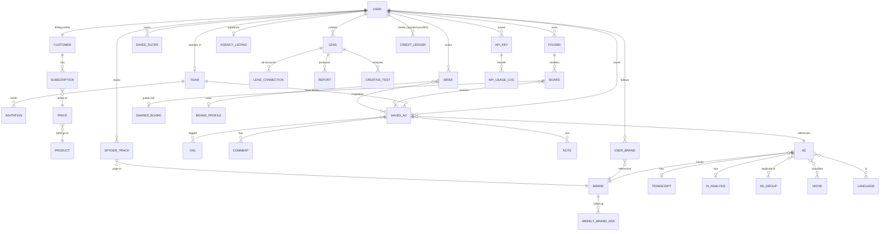
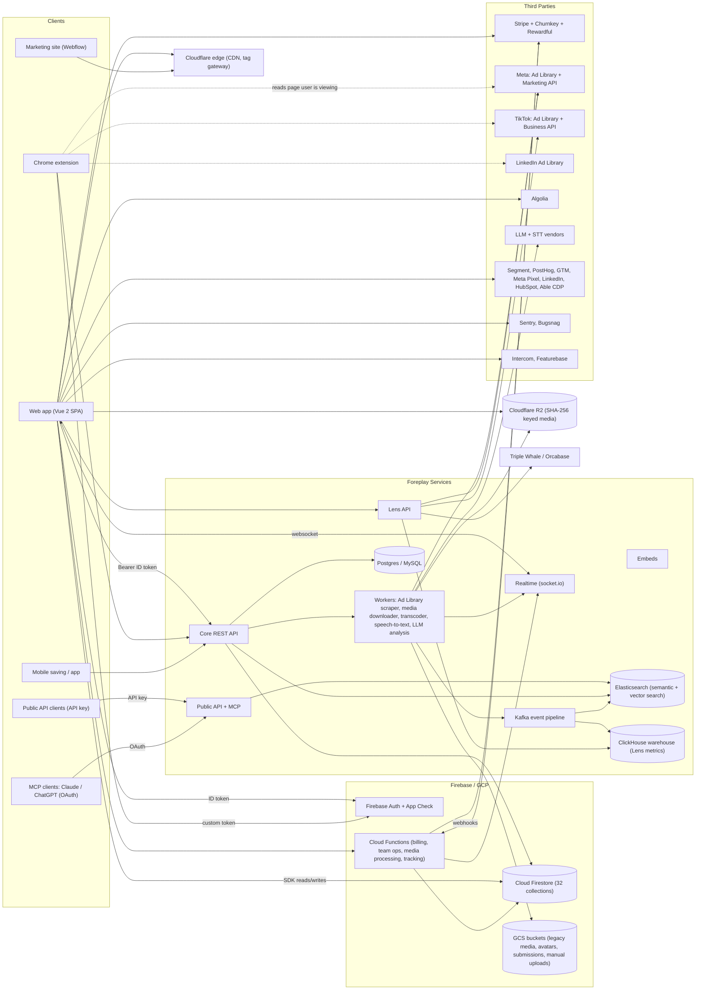

# Ad Creative Intelligence Platform: Opportunity Brief

## Executive Summary

Foreplay is a workflow tool for paid-social creative teams. It covers the complete loop: find, save, organise, analyse, brief.

- **Save.** Ads are saved from ad libraries and social feeds with a Chrome extension and mobile apps.
- **Swipe File.** Saved ads are organised into boards and folders, with automatic transcription and AI tagging.
- **Discovery.** A community-sourced, searchable ad library with 50-100M+ ads indexed.
- **Spyder.** Monitors competitors' Meta ads around the clock, with longevity and velocity rankings.
- **Lens.** Analyses the customer's own Meta/TikTok creative performance (spend, CTR, CPA, ROAS, hook rate, hold rate).
- **Briefs.** Turns saved inspiration into AI-assisted creative briefs and scripts.
- **API and MCP.** Everything is exposed through a credit-metered public API and an MCP server, so Claude, ChatGPT and other AI agents can use the data.

### Target Users

Performance marketers, creative strategists, media buyers, UGC/creative agencies and DTC/e-commerce brands. Also mobile apps/gaming, B2B/SaaS, info/education and freelancers. Named customers include AG1, Dr. Squatch, Rhode, Lululemon and Paramount.

### Core Value Proposition

1. **Never lose an ad.** A permanent copy survives the ad being taken down from the library.
2. **Search across a large shared corpus.** Marketing claims range from 54.7M (live counter) to "200M+"; likely 50-100M unique creatives.
3. **Automated competitor tracking** with longevity and velocity rankings.
4. **Creative analytics** that link "what competitors do" with "what works for us."
5. **Briefing and collaboration** in one place.
6. **Agent access** via API and MCP for AI-native workflows.

### Business Model and Pricing

| Plan | Monthly | Annual (per month) | Seats | Notable Inclusions |
|---|---|---|---|---|
| Basic | $59 | $49 | 1 | Swipe File, Discovery, Briefs |
| Workflow | $175 | $149 | 5 | + Spyder (15 brands; unlimited on annual), Lens (1 brand), AI-tool connection (MCP/API) |
| Agency | $459 | $389 | 10 | Spyder 50 brands, Lens 10 brands |
| Enterprise | custom | custom | unlimited | Unlimited use, Slack support |

- **Add-ons:** extra users $20 each; extra Lens brands $50 each regardless of ad spend.
- **API credits:** 10k/month on non-legacy plans, 20k/month on annual. Top-ups $99 / $189 / $349 per month for 100k / 250k / 500k credits.
- **Trial:** 7 days, card required on the pricing page; 14-day money-back guarantee; no free tier.

### The Company

- Bootstrapped and profitable; no outside investors.
- Revenue estimated at single-digit millions ARR, growing 75%+ year-over-year for three years.
- About 11 staff. Founded 2021, Toronto. Started as a Chrome extension called Adison.io; acquired GetSpyder in 2023.
- Chrome extension: 20,000+ users. Listed on G2 with strong reviews.

### Key Takeaways

1. **The stack is pragmatic and Firebase-centric at the edges.** Vue 2.7 SPA with Vuex and webpack, Firebase Auth, App Check and Firestore accessed directly from the browser (32 collections), Cloud Functions for billing and team operations. Separate services for the core API, Lens API, public API/MCP and socket.io notifications. Cloudflare edge and R2 for content-addressed media. The heavy data plane uses Kafka, ClickHouse, Elasticsearch, Postgres/MySQL, Node/Python.
2. **Monetisation is layered meters, not just seats.** Plan tier + seats + Spyder brand credits + Lens brand slots + API credits, all enforced in the UI and pushed live over socket.io.
3. **Spyder and Discovery depend on the Meta Ad Library**, which is now under tighter terms (anti-automation even when logged in, from 2025). Spyder is Meta-only.
4. **Lens outsources Meta account connectivity to Triple Whale's Orcabase** and computes percentile-per-dollar scores (Hook, Watch, Click, Convert, Viral). This is a partner dependency that can be avoided by using the Marketing API directly.
5. **AI is everywhere but server-side**: automatic transcripts and AI analysis on every saved ad, hooks, AI briefs, AI agency listings, MCP prompts. Their job post says the AI is in-house.
6. **Notable weaknesses:** publicly served production source maps; end-of-life Vue 2 and Firebase v8; heavy client (~7 MB of JS on Discovery and ~15 third-party scripts); two error monitors and two session-replay tools running simultaneously; inconsistent public numbers.
7. **Market gap to target:** cross-network coverage (especially Google/YouTube via the Transparency Center and TikTok via its official API); reach-aware EU intelligence; agent-first API/MCP from day one; regional pricing for India, SEA and LatAm.
8. **Infrastructure is cheap relative to revenue.** A comparable product runs at roughly $0.6-1k/month at 100 users, $3-5k at 1,000 and $22-32k at 10,000. AI tagging and search are the cost drivers; dedupe per creative is the key lever.

---

## Tech Stack

### Frontend

| Layer | What They Use | Notes |
|---|---|---|
| Framework | Vue 2.7.16 with Vuex 3.6.2 and webpack (Vue CLI) | Vue 2 reached end of life Dec 2023; templates compiled as render functions |
| Language | JavaScript (no TypeScript found in parsed source maps) | .vue single-file components plus .js utilities |
| App shell | Single-page app with sidebar layout, per-module views | 112 lazy route chunks registered in webpack; each module tab loads its own chunk |
| Design system | In-house component set (icons, paywall cards, tutorial modals, drawer components) | No external component library |
| Styling | Utility-class tokens consistent with Tailwind CSS compiled at build time | Inter typeface self-hosted |
| Command palette | ninja-keys web component (Cmd+K style) | Present in DOM and bundle |
| Masonry grid | vue-stack-grid, vue-images-loaded | For ad card layouts |
| Infinite scroll | vue-infinite-loading | Pagination UX |
| Charts | ApexCharts (740 references in lazy chunks) | Used by Lens and Spyder |
| Rich text | TipTap with link and character-count extensions | Used in ad-drawer notes and briefs |
| Animation | Lottie via Lottielab CDN | Onboarding and UI animations |
| Zip export | JSZip | Bulk ad media download |
| Bundle size | vendor chunk 3.99 MB, app chunk 1.65 MB minified; Discovery loads ~7 MB across 8 files | Slow first load on mobile |

### Backend and Infrastructure

| Layer | What They Use | Notes |
|---|---|---|
| BaaS | Firebase project (Auth, Firestore, Storage, Cloud Functions, App Check) | 32 collections accessed directly from the browser |
| Core REST API | Node and Python services (~70 repositories per their job post) | Separate from Firebase |
| Lens API | Separate service on its own hostname | Independent scaling for analytics |
| Public API + MCP | Separate service handling both REST API and MCP server | OAuth for MCP, API keys for REST |
| Realtime | Socket.io service on dedicated hostname (websocket transport) | Pushes ad-saved events, subscription changes, credit limits |
| Event pipeline | Kafka | For ad ingestion, processing, indexing |
| Search engine | Elasticsearch with semantic and vector search | Faceted search, autocomplete, similarity |
| Analytics warehouse | ClickHouse (multi-billion-row; Lens metrics compiled to ClickHouse SQL) | Columnar analytics for creative performance |
| Relational databases | Postgres and MySQL (roles unknown) | Alongside Firestore and ClickHouse |
| Media storage | Cloudflare R2 (current, SHA-256 content-addressed keys) and GCS (legacy, page-ID-keyed) | Separate buckets for avatars, submissions, manual uploads |
| CDN/Edge | Cloudflare (DNS, CDN, Rocket Loader, first-party tag gateway) | In front of both app and marketing site |
| Marketing site | Webflow | Separate from the app |

### Authentication

| Method | How It Works |
|---|---|
| Web app login | Firebase Auth (email/password or Google popup); short-lived ID tokens as Bearer headers; App Check with reCAPTCHA |
| Extension auth | App mints a custom token that the extension uses via a token-login handoff |
| MCP auth | OAuth authorization page hosted in the web app |
| Public API auth | API key issued in-app (masked, with copy and rotate) |
| Meta for Lens | Facebook JS SDK OAuth with ads_read and business_management scopes; data-deletion callback implemented |

### Payments and Monetisation

| Component | Details |
|---|---|
| Billing | Stripe (setup intents, checkout sessions, customer portal, invoices, coupons/promo codes, seat quantities) |
| State mirror | Stripe state synced to Firestore; subscription changes pushed over socket.io so UI unlocks instantly |
| Retention | Churnkey for pause/cancel flows |
| Invoices | Zenvoice (Stripe invoice self-service) |
| Affiliates | Rewardful plus in-house referral program with PayPal payouts |

### Analytics and Monitoring Stack

| Category | Tools |
|---|---|
| Product analytics | Segment analytics.js + PostHog via first-party proxy |
| Advertising pixels | Google Tag Manager + gtag, Meta Pixel + FB JS SDK, LinkedIn Insight Tag, Triple Whale pixel |
| CRM/CDP | HubSpot (marketing site + CRM sync), Able CDP (server relay) |
| Visitor identification | RB2B (marketing site), OptinMonster (marketing site) |
| Error monitoring | Sentry for Vue (with replay) + Bugsnag (running two simultaneously, likely mid-migration) |
| Support | Intercom Messenger |
| Changelog/feedback | Featurebase SDK |
| Feature flags | Firestore beta-users collection + isBetaUser gating; PostHog flags available but usage unknown |

---

## How Each Feature Works

### Sign-up, Login and Session

The sign-up flow offers email/password or "Continue with Google." Firebase Auth handles identity with short-lived ID tokens. Custom-token sign-in supports magic links and the Chrome extension handoff. Email verification and password reset use Firebase action codes. On sign-up, the backend creates the user document, pushes attributes to HubSpot and Segment, starts the trial via Stripe, and sets the onboarding stage. A Launchpad checklist (install extension, save first ad, connect MCP, run first prompt) guides new users with progress tracking (showed 31% on the analysed account).

### Saving an Ad

This is the core action and works from multiple entry points: the Chrome extension on Meta/TikTok/LinkedIn ad libraries, the Discovery search results, Spyder ad views, manual upload, and mobile share-sheet.

The flow:
1. User clicks "Save" and selects target boards.
2. Frontend builds the ad payload and calls the save endpoint.
3. Backend de-duplicates against the global corpus using the platform ad ID plus a media hash.
4. Media is downloaded from the platform CDN and stored on R2 under a SHA-256 key (content-addressing gives free deduplication across all users; a viral ad saved by 1,000 users is stored once).
5. Post-processing is enqueued: frame screenshots, transcript (speech-to-text), AI analysis (hook text, emotional drivers, persona, content type, funnel stage, niche).
6. The user/team library record and board membership are written.
7. A socket event fires so open library tabs refresh in real time.
8. Optionally the ad is marked discoverable, feeding the community corpus.

### Swipe File (Library), Boards, Folders, Tags, Ratings, Notes

The library view has tabs for My Ads, Team Ads, Brands (followed), and Mobile Saving. Ads live inside boards, boards inside folders. Features include star ratings (1-5), colour-coded tags, rich-text notes (TipTap editor), comments, transcript and AI-analysis tabs, DCO preview, same-creative grouping, sort and filter, bulk move/tag/delete, and bulk download as ZIP (via JSZip in the client). Public share links let anyone view a board or ad without a Foreplay account. Board counts are aggregated server-side with Firestore sharded counters.

### Discovery (Community Ad Search Engine)

Discovery has tabs for Community Feed, For You, Shuffle, and New, plus Brands and Experts tabs. The search supports keywords, brands and categories with autocomplete. Filters include platform (10 values including Meta, TikTok, LinkedIn, YouTube, Pinterest, Google), format (video, image, carousel, DCO, DPA, text, event), language, niche, live status, product category, creative targeting, and sort (newest, oldest, longest running, most relevant). Results paginate with a cursor.

The backend uses Elasticsearch with semantic and vector search, plus Algolia for at least one InstantSearch surface. "For You" personalises results based on user niches set during onboarding. Shuffle returns randomised samples.

### Spyder (Competitor Tracking)

Users add a competitor brand by Facebook Page ID or search. Foreplay tracks Meta ads only (no TikTok, no LinkedIn, no Google). The system runs around the clock; a new brand's active ads load in 5-10 minutes; history goes back to August 2023 for 20k+ brands.

A scheduler iterates tracked page IDs, queries the Meta Ad Library, and upserts ads with first-seen/last-seen dates. Ads that disappear are marked inactive. This drives the ranking system:
- **Breakout**: recently launched ads
- **Evergreen**: ads running for a long time (proven winners)
- **Peak**: ads at highest activity
- **Trend**: ads showing momentum

Additional features: creative velocity charts (new ads per period), monthly traffic data, partner/whitelisted ads detection, and a Hook Mining Lab that extracts and ranks hook text from competitor ads. Weekly roll-ups aggregate brand activity.

Credits limit how many brands you can track: 15 on Workflow ($149/mo), 50 on Agency ($389/mo). Extra brands are paid add-ons. Limits are pushed in real time over socket.io.

### Lens (Creative Analytics on Connected Ad Accounts)

Users connect their own Meta or TikTok ad account via OAuth. Meta accounts connect through Triple Whale's Orcabase integration. The creation flow walks through selecting the data source, choosing ad accounts, setting currency and timezone.

Historical sync takes hours to days; Lens becomes usable after 7 days of data. Data is synced nightly and on-demand, stored in ClickHouse, and joined to creative media.

Metrics: spend, impressions, CTR, CPA, ROAS, thumbstop/hook rate (3-second views / impressions), hold rate (completed views / 3-second views). Foreplay computes percentile-per-dollar scores across five dimensions: Hook, Watch, Click, Convert, and Viral Engagement.

Features include benchmark cards with percentage-change indicators, comments on creatives, creative tests (A/B comparison), inspiration linking, and shareable reports with public links. Data deletion is supported with a token wipe for Meta compliance.

Credits limit: 1 Lens brand on Workflow, 10 on Agency, +$50 per extra brand.

### Briefs (AI-Assisted Creative Briefs)

Users create briefs with a brand profile and selected inspiration ads. The status board tracks briefs through: No Status, To Do, In Progress, Needs Review, Completed. The TipTap rich editor supports storyboard and script blocks.

The AI pipeline assembles the brand profile, selected ads (with their transcripts and AI analysis), and the user's goal into a structured brief containing hooks, script beats, shot lists, and CTAs. Variations can be generated with different constraints.

Briefs have public share links for team collaboration.

### Transcripts, AI Analysis and Hooks

Every saved video ad gets automatic transcription (speech-to-text). The AI then extracts: hook text (first ~3 seconds), emotional drivers (15 scores like urgency, fear, curiosity, social proof), target persona, content type (testimonial, UGC, product demo, etc.), funnel stage, creative targeting, and niche classification.

Results are cached per unique creative and reused for all users who save the same ad. A pending state shows "Transcript is still being generated" while processing.

The Hook Mining Lab lets users browse, search and pin hooks from competitor ads.

### Public API and MCP

The public API (launched mid-2026) uses API keys and a credit meter. Every ad returned costs 1 credit. Credits are shared between the API and MCP. The API supports searching ads, fetching individual ads, getting brand ads, board ads, Spyder data, and Discovery search. Pagination uses cursors with a maximum of 250 results per request. Response headers show remaining credits, credit cost per call, trace ID and processing time.

The MCP server uses OAuth (users sign in with their Foreplay account). Setup flows exist for Claude and ChatGPT. A bundled catalogue of guided "wow" prompts helps users discover what they can do. The MCP exposes search, transcripts, brand analysis and ad-result display tools.

### Teams, Seats and Collaboration

Workspaces support invites by token, collaborator roles, and seat management (included vs. paid vs. in use). Team members share a library with Team Ads. Admin operations include adding users, removing members, and migrating users between teams. Team deletion is asynchronous (team-delete-jobs).

### Other Features

- **Experts/Agency Directory**: moderated directory with AI-assisted listing generation, country and industry taxonomies, avatar uploads, and public share links.
- **Bounties/Perks**: dedicated views (content not fully analysed).
- **Chrome Extension**: Manifest V3 extension (v3.3.4, ~20k users, 4.7 stars). Saves from Meta Ad Library, Instagram feed, TikTok (EU ad library, Top Ads, organic), LinkedIn Ad Library and YouTube Shorts. Google Transparency Center support "coming soon."
- **Mobile**: iOS and Android apps for share-sheet saving and camera uploads. Built with React Native.
- **Embeds**: embeddable ad players/cards for external sites.
- **Growth Tools**: Rewardful affiliate program, in-house referral with PayPal payouts, G2 review prompts.

---

## ER Diagram (Entity Relationships)

### Key Entities

**USER** (auth-users): uid, email, name, avatar, teamId, plan/basePlan/interval (basic_plan, workflow_plan, agency_plan, legacy plans), isFreeTier, trial dates, isBetaUser, onboarding state (stage, attributes, niches for personalisation), setup progress (Launchpad checklist), extension installed flag, expert profile, referral code and PayPal email.

**TEAM** (teams): id, name, avatar, ownerId, adminIds, memberIds, seats (included, paid, in use), workspace settings.

**AD** (global corpus): id (internal), ad_id (platform/public ID like Meta Ad Library ID), brand_id, name, headline, description, cta_title, cta_type, link_url, display_format (video/carousel/image/dco/dpa/multi_images/multi_videos/multi_medias/event/text), publisher_platform array (facebook/instagram/audience_network/messenger; app also handles tiktok/linkedin/youtube/pinterest/twitter/google), video/image/thumbnail/cards/avatar URLs (R2/GCS with content-hash keys), video_duration, started_running, running_duration, live status, full_transcription, timestamped_transcription, categories, product_category, creative_targeting, niches, market_target (b2b/b2c), languages, emotional_drivers (15 scores), persona, content_filter (14 types), foreplay_url (deep link), pageId (229 code references), duplicate group, ranking (active/inactive, breakout/evergreen/peak/trend), discoverable flag.

**SAVED_AD** (user/team library item): id, adId (reference to AD), ownerId, teamId, boardIds, tagIds, rating (1-5), source (extension/discovery/spyder/manual/mobile), savedAt.

**BRAND** (brands): id, name, description, avatar, category, niches, verification_status, url, websites, ad_library_id (Meta page ID), delegate page flag, platforms, ad count, active ad count, monthly traffic, partners.

**SPYDER_TRACK** (fb_ads_page_track): pageId, userId/teamId, status (with "Fix" flow for broken trackers), createdAt, lastScrapedAt, creditCost.

**LENS**: id, ownerId, brandName, platform (Meta/TikTok), adAccountIds, currency, timezone, status, lastRefreshedAt. Related: LENS_CONNECTION (provider, access token, scopes, expiry), REPORT (id, lensId, title, blocks, share link), CREATIVE_TEST (lensId, variants, metric, winner).

**BRIEF** (briefs): id, title, status (No Status/To Do/In Progress/Needs Review/Completed), brandProfileId, content (TipTap rich text with storyboard and script blocks), inspirationAdIds, variations, shareId.

**Other entities**: FOLDER (id, name, owner, boards, isDefault, starred), BOARD (id, name, folderId, owner, adCount, isPublic), TAG (id, name, colour, owner), COMMENT (id, target, author, body, createdAt), NOTE (id, adId, author, richText, updatedAt), SAVED_FILTER (id, owner, name, filter JSON), BRAND_PROFILE (name, description, products, audience, tone, assets), AGENCY_LISTING (name, avatar, country, services/industries, AI-generated description, status), API_KEY (key masked, created, lastRotated), API_USAGE_LOG (operation, usage), CREDIT_LEDGER (Spyder credits "0/15", Lens limit "0/1", API credits 10k/month).

**Platform/config collections**: niches (taxonomy), languages (taxonomy), dynamic-constants (remote config), beta-users, counters/shards (distributed counters), team-delete-jobs, extension-gpt-promps (prompt templates for the extension).

---

## System Architecture

### Architecture Notes

- **Five separate service hostnames** for core API, Lens API, public API/MCP, notifications and embeds. This is a micro-service split by product line.
- **Compute platform is unknown.** Cloud Run or App Engine is likely given the App Engine dev host found in the code.
- **Scale:** about 2M new ads ingested per day and hundreds of millions indexed (from their job post).
- **Dev hostnames ship in the production bundle** (dev API, dev Lens API, App Engine dev host), exposing the environment layout.

---

## Ad-Data Ingestion and Refresh Pipeline

Four entry points feed one corpus:

### 1. User Saves (Extension, Mobile, Manual Upload)

The Chrome extension reads the ad payload already rendered in the user's browser on the ad-library page and posts it to the API. The backend fetches the canonical record (e.g. by Meta archive ID), downloads the media, and stores it in R2 under its SHA-256 hash. The hash gives cross-user deduplication; the duplicate-group UI shows when multiple users save the same creative.

### 2. Spyder Tracking (Scheduled Scraping)

A scheduler iterates tracked Facebook Page IDs, queries the Meta Ad Library (method unknown: web surface and/or Ad Library API), and upserts ads with first-seen/last-seen dates. Ads that disappear are marked inactive, which drives the Breakout / Evergreen / Peak / Trend classification. Media URLs organised under `<bucket>/<pageId>/<id>` on GCS show that historical scraping was organised per advertiser page.

Per the public help centre: Meta only, new brand loaded in 5-10 minutes, history from August 2023.

### 3. Discovery Corpus

The corpus is the union of user-saved ads marked discoverable and Spyder-scraped ads, indexed for faceted search. Refresh cadence is unknown. The site's ad-count claims conflict across pages (54.7M on the live counter vs "100M+" vs "200M+"); treat these as marketing figures.

### 4. First-Party Performance Data (Lens)

Insights are pulled with the customer's own consented OAuth connections (Meta Marketing API, TikTok Business API) via Triple Whale/Orcabase. This data stays private per workspace and does not enter the public corpus. Metrics are compiled into ClickHouse SQL.

### Processing Pipeline

For each unique creative:
1. Audio extracted from video
2. Speech-to-text transcription
3. LLM extraction: hook text, angles, emotional drivers (15 scores), funnel stage, format tags
4. Results stored per unique creative and reused for all users who saved it

The job post describes in-house AI for transcription, classification and embeddings. Any third-party model vendor is unknown.

---

## Legitimate Data-Acquisition Strategy

**Principle: build the corpus from official repositories, user-initiated saves and first-party connections. Never ingest a competitor's data, outputs or API responses, and never scrape at scale behind logins.**

### Sources Ranked by Legitimacy

| Source | What You Get | Access and Limits | Terms / Risk | Product Use |
|---|---|---|---|---|
| **Users' own ad accounts** (Meta Marketing API, TikTok Business API) | Full performance + creative for their ads | OAuth; Meta app review; per-app rate limits | Clean with consent; must honour data-deletion callbacks | Lens-style analytics; private per workspace |
| **Meta Ad Library API** (ads_archive) | All ads that reached the EU (DSA, kept 1 year) + social-issue/political ads elsewhere. Copy fields, delivery dates, page, platforms, languages, EU reach and payer/beneficiary, EU/UK targeting summaries. No direct media URLs (media render via snapshot page) | Developer app + ads_read; ID verification (1-3 days); tokens ~60 days; undocumented rate limits | Platform Terms prohibit selling/licensing Platform Data. A paid SaaS redistributing API data is a poor fit; design as "analysis + link to source." Get legal advice | EU/UK commercial discovery and tracking; reach-ranked feeds |
| **TikTok Commercial Content API** | EU ads with first/last shown, status, reach, advertiser, video and image URLs (signed) | Application (~2 working days); max 10 results per request; general throttling | Developer ToS | EU TikTok discovery |
| **Google Ads Transparency Center** (BigQuery public dataset) | Advertiser, creative ID and page URL, format, first/last shown by region, impression bands, audience-selection flags, removals (EEA + Turkey; since March 2023) | Free public dataset; BigQuery query costs only | Google ToS + Transparency Center additional terms | Cross-network advertiser activity; link-outs |
| **Other DSA Art. 39 repositories** | Snapchat Ads Gallery API (open, EU 12 months); Microsoft Ad Library API (EEA, unauthenticated tier); X ads repository API (EU); Pinterest (web only); Amazon (interface, no API found) | Varies | Generally designed for public access; check each ToS | Long-tail coverage |
| **LinkedIn Ad Library** | Ads since June 2023; EU impressions and targeting | A gated "Ad Library API" is reported but status is conflicting | Unknown terms | Extension saves until an API is confirmed |
| **User-initiated saves via extension** | Whatever the user is viewing when they click Save | Per-click, user-driven | Meta's 2025 terms ban automated collection even when logged in; keep saves strictly manual (no background crawling) and minimal | Swipe file core |
| **Brand/agency uploads and partnerships** | Owned creatives, licensed archives | Contracts | Clean | Templates, expert boards, benchmarks |

### Legal Landmarks to Brief Counsel On

- **Meta v. Bright Data (N.D. Cal., Jan 2024).** Logged-off scraping of public data was not barred by Meta's terms then in force. Meta dropped the case, then broadened its terms from 2025 to cover logged-in scraping and circumvention.
- **hiQ v. LinkedIn.** Public-page scraping was likely not a federal computer-crime violation, but LinkedIn won on contract; hiQ settled with an injunction and data deletion. Terms of service can be enforced.
- **EU database right.** Substantial (or repeated systematic) extraction from protected databases infringes. Ryanair allows contractual bans on scraping even of unprotected databases. CV-Online requires harm to the maker's investment.
- **GDPR.** Ads that show people are personal data; you need a lawful basis (usually legitimate interests), notices and a DSR process. Regulators fined Clearview over scraped faces.
- **Copyright in creatives.** Storing and displaying third-party ads is a copyright question. US search-thumbnail cases favour transformative use, but Warhol (2023) cuts against same-purpose commercial use. The EU TDM exception (Art. 4) permits mining unless rights-holders opt out. Implement notice-and-takedown and avoid bulk redistribution via the API.
- **DSA Art. 40 researcher access** is for vetted, non-commercial researchers. It is not a commercial data route.

### Practical Policy

1. **Corpus = official EU/UK repositories + user saves + owned uploads.** Label each ad's source and region.
2. **Store media you are allowed to fetch.** For Meta, where the API returns no media URLs, show the snapshot via link or embed, or rely on user-initiated saves.
3. **Expose ads through your public API as references and analysis** (IDs, tags, transcripts, your metrics), not as a bulk media re-host.
4. **Keep the rest of the house in order:** retention schedules, takedown workflow, sub-processor list, DPA, and a "do not train on customer data" default.

---

## Infrastructure, Third-Party Services and Monthly Cost Estimates

### Assumptions

- Unique new creatives per month: 40k at 100 users, 250k at 1k, 1.5M at 10k (dedupe improves with scale).
- 50% video, averaging 30 seconds; average stored size 4.5 MB per creative.
- Storage shown at month 12 of growth.
- AI tagging uses about 6k input + 0.5k output tokens per creative on a Haiku-class model with 50% batch discount.
- Briefs average 4 per user per month on a mid-tier model.
- Prices are publicly listed vendor prices (sources in the Public Sources section below).
- Excludes salaries and Stripe fees.

### Cost Breakdown

| Line Item | 100 users | 1,000 users | 10,000 users | Basis |
|---|---|---|---|---|
| R2 storage (cumulative ~2.2 / 13.5 / 81 TB) | $35 | $205 | $1,215 | $0.015/GB-mo, free egress |
| R2 operations | $5 | $20 | $120 | $4.50/M writes, $0.36/M reads |
| Speech-to-text (10k / 62k / 375k min) | $30-45 | $190-270 | $1,100-1,600 | $0.003-$0.0043 per min |
| AI tagging (per creative) | $85 | $530 | $3,200 | Haiku-class, batch pricing |
| AI briefs / generation | $40 | $360 | $3,600 | ~$0.09 per brief, mid-tier model |
| Embeddings / vectors | $5 | $30 | $200 | Small embedding model |
| Search (Typesense / Meilisearch / OpenSearch) | $60-150 | $300-600 | $2,000-4,000 | Scales with docs and RAM |
| Postgres (Neon / Supabase) | $25-70 | $200-400 | $1,500-3,000 | Supabase Pro $25; Neon $0.106-0.222/CU-hr |
| API + worker compute (incl. FFmpeg) | $100-150 | $600-800 | $4,000-5,000 | Fly/Render/Cloud Run |
| Redis / queues | $10 | $50 | $300 | Upstash/managed |
| Cloudflare (DNS/CDN/WAF, Images) | $25 | $50-250 | $200-1,000 | Pro to Business as traffic grows |
| Support (Intercom) | $60-170 | $400-700 | $1,500-3,000 | $29-85/seat + Fin $0.99/resolution |
| Product analytics (PostHog) | $0 | $0-450 | $1,500-2,500 | 1M events + 5K replays free |
| Errors (Sentry) | $26 | $80 | $300 | Team $26/mo base |
| Auth (Clerk/Better Auth), email (Resend/Postmark) | $20-45 | $100-250 | $800-1,500 | Estimates |
| Official data sources (Meta/TikTok/Snap/Microsoft APIs; BigQuery) | $0-20 | $20-100 | $100-500 | APIs free; BigQuery query cost |
| **Total (approx.)** | **~$550-950/mo** | **~$3,200-5,200/mo** | **~$22,000-32,000/mo** | |
| Revenue at ARPU $99 | $9,900 | $99,000 | $990,000 | Foreplay's plans are $49-$389/mo annual |
| Stripe fees at that revenue | ~$390 | ~$3,900 | ~$39,000 | 2.9% + 30c + 0.7% Billing |

### Key Takeaways

- Gross infrastructure stays around 3-9% of revenue at a $99 ARPU. Very healthy margins.
- The biggest variable costs are AI tagging, briefs and search, so dedupe per creative and route bulk work to a cheap model.
- Media storage stays cheap on R2 because egress is free. Doing the same on GCS would add $0.12/GiB egress, which matters at 10k users.

---

## Security, Performance and Infrastructure Observations

### Security

| # | Observation | Severity | Notes |
|---|---|---|---|
| S-1 | **Production source maps are publicly downloadable for all 11 app chunks.** They contain original Vue/JS sources, file paths, comments and module structure, making reverse engineering trivial. | High | Stop deploying *.map or upload maps privately to Sentry/Bugsnag only. |
| S-2 | **Direct Firestore access from the browser across 32 collections**, including customers, subscriptions, teams, invitations and auth-users. Data isolation rests entirely on Security Rules and App Check. | Medium | Audit rules with the emulator test suite. Move sensitive reads behind the API. |
| S-3 | **Dev/staging hostnames shipped in the production bundle.** This exposes the environment layout. | Low-Medium | Tree-shake by build-time env; protect dev with Cloudflare Access. |
| S-4 | **Public r2.dev bucket URL referenced in a Lens chunk.** r2.dev URLs are rate-limited and Cloudflare advises against them in production. | Low | Serve through the custom domain only; disable r2.dev access. |
| S-5 | **Client-visible service identifiers** (Firebase web config, Stripe publishable key, Segment write key, PostHog project key, Intercom app ID). These enable event spoofing and quota abuse. | Low | Use server-side event relays for billing-relevant analytics. |
| S-6 | **Session replay from two vendors** (Sentry Replay, PostHog) on an app that displays emails, billing data and API keys. | Medium (privacy) | Mask inputs and the API-key element; restrict replay sampling. |
| S-7 | **Two error monitors (Sentry + Bugsnag)** doubles third-party data egress. | Low | Consolidate. |
| S-8 | **Auth model is sound for an SPA**: short-lived Firebase ID tokens, no cookies, App Check with reCAPTCHA. | Positive | |
| S-9 | **API key shown masked with copy and rotate**; MCP uses OAuth instead of pasted keys. | Positive | |
| S-10 | **Meta data-deletion callback and token-wipe endpoint exist** (required by Meta Platform Terms). | Positive | |
| S-11 | **Outdated runtimes**: Vue 2 (end of life Dec 2023) and Firebase JS SDK v8 (from 2021). | Medium | Migrate to Vue 3 and Firebase SDK v10+. |

### Performance

| # | Observation | Impact |
|---|---|---|
| P-1 | Initial JS on Discovery is about 7 MB across 8 scripts (vendor 3.99 MB, app 1.65 MB, Discovery chunks ~1.2 MB), before compression. | Slow first load on mobile and low-end devices. |
| P-2 | Algolia/InstantSearch code is duplicated across several lazy chunks (~900 matches vs ~230 in vendor). | Wasted bytes; should be split into a shared async chunk. |
| P-3 | 158 hard-coded GCS media URLs in one chunk (demo/onboarding content). | Bundle bloat; should be moved to a JSON endpoint. |
| P-4 | 112 route-level lazy chunks; Cloudflare edge; R2 for media (no egress fees); progressive video. | Positive |
| P-5 | Cloudflare Rocket Loader on a webpack SPA can reorder script execution. | Minor risk. |
| P-6 | ~15 third-party scripts (analytics, pixels, chat, changelog, retention) load in the authenticated app. | Main-thread cost; consent complexity. |

---

## Risks and Mitigations

| Risk | Likelihood | Impact | Mitigation |
|---|---|---|---|
| Platform terms / access revocation (Meta, TikTok, LinkedIn) | Medium | High | Prefer official APIs; keep the extension "save what the user sees" model; legal review of each source; multi-source design so no single platform is fatal. |
| Ad Library API coverage gaps (non-EU commercial ads not in the API) | High | Medium | Position on EU/UK + user-contributed corpus + first-party analytics; add Google Transparency Center; be transparent about coverage. |
| Copyright / personality rights in stored creatives | Medium | Medium | Store for analysis/reference; honour takedowns (DMCA/EU notice-and-action); do not redistribute media via the public API without platform links; limit downloads on shared links. |
| Chrome Web Store policy rejection | Medium | Medium | Minimal permissions, clear single purpose, privacy policy, no remote code. |
| Media, STT and LLM costs scaling with saves | Medium | Medium | Content-addressed dedupe; process once per creative; cheap models for tagging; transcribe only video ads with audio; cache aggressively. |
| Search cost/latency at 10M+ docs | Medium | Medium | Typesense sharding or OpenSearch; tiered indexes (active vs archive). |
| Meta app review delays for Marketing API | High | Medium | Start review early; launch analytics later; CSV import fallback. |
| Competitive response (Foreplay, Motion, Atria, MagicBrief) | High | Medium | Differentiate on coverage breadth, regional focus, AI depth and agent-first design; price for underserved segments; ship MCP/API early. |
| Data-protection (GDPR) for people in creatives and for user data | Medium | Medium | DPA with processors, EU hosting option, data-subject request process, retention policy. |
| Abuse of the public API (bulk exfiltration) | Medium | Medium | Credits, rate limits, per-key anomaly detection, contractual limits. |

---

## Competitive Price Landscape (Public List Prices)

| Product | Price | Positioning |
|---|---|---|
| Swipekit | $26 / $46 / $66 per month | Low-cost swipe file with API and MCP |
| Foreplay | $49 / $149 / $389 per month (annual) | Swipe file + Discovery + Spyder + Lens + Briefs + API/MCP |
| Minea | $49 / $99 / $199 per month | Dropshipping ad and product spy |
| BigSpy | Free; $69-$499 per month | Multi-platform ad spy (up to 11 platforms) |
| Panoramata | $99 / $179 / $399 per month | Competitor marketing tracking (ads, email and more) |
| Atria | $129 / $343 / $959 per month (annual) | AI creative research + own-account analytics |
| AdSpy | $149 per month | Large Facebook/Instagram ad database |
| MagicBrief | From $249 per month (priced by ad spend) | Creative analytics + briefs + inspiration |
| Motion | From $999 per month | Creative analytics for high spenders |

**Implication.** A credible entrant can price between Swipekit and Foreplay's Workflow plan. The way to win is coverage and AI depth, not undercutting on price alone. Strong India/SEA/LatAm pricing ($15-30/month entry tier) and native-language search would open markets that none of these players serve today.

---

## Differentiation Opportunities

1. **Reach-aware EU intelligence.** Surface DSA fields (EU reach, targeting summaries, delivery dates) that most swipe tools ignore; rank ads by estimated reach and longevity together.
2. **Cross-network coverage.** Meta + TikTok + LinkedIn + Google/YouTube (Transparency Center) in one search, with clear source badges.
3. **AI creative taxonomy with evals.** A published, consistent tagging schema (hook type, angle, offer, persona, format, emotion, CTA), quality-checked with eval sets; let teams add custom tags trained on their labels.
4. **"Why it works" plus performance join.** Combine competitor inspiration with the customer's own performance to recommend which competitor patterns to test next.
5. **Agent-first.** Ship MCP, a Claude Skill and an API from early releases with generous free credits; make every object deep-linkable.
6. **Regional pricing and languages.** Strong India/SEA/LatAm pricing and native-language search (Hindi, Telugu, Bahasa, Portuguese, Spanish) where incumbents are US-centric.
7. **Production bridge.** Brief to storyboard to script to asset checklist, with handoffs to UGC creators and editors (marketplace or integrations).
8. **Privacy-first trust.** No public source maps, minimal trackers, EU residency and a public sub-processor list as a sales advantage with agencies and enterprises.

---

## Public Sources

### Foreplay: Product, Pricing, Docs

| URL | Supports |
|---|---|
| https://www.foreplay.co/pricing | Plans, prices, seats, Spyder and Lens limits, trial terms, plan comparison |
| https://www.foreplay.co/faq | "No usage limits"; 2 free Spyder scrapes |
| https://www.foreplay.co/api | API top-up prices; 100M+ / 300k+ brands claims |
| https://public.api.foreplay.co/openapi.json | Public API endpoints, auth, envelope, credit costs, enums, ad and brand fields, MCP transport |
| https://foreplay.co/post/how-to-search-ads-using-the-foreplay-api | Discovery search parameters |
| https://foreplay.co/mcp | MCP clients, sign-in flow, freshness claim |
| https://www.foreplay.co/faqs/what-can-i-actually-do-with-the-foreplay-mcp | MCP capabilities |
| https://foreplay.featurebase.app/changelog | MCP launch date, Lens out of beta, Discovery filters |
| https://www.foreplay.co/ships | Release history |
| https://help.foreplay.co/ | Help-centre collections |
| https://help.foreplay.co/en/articles/9082255-credits-and-pricing | API credits per plan |
| https://help.foreplay.co/en/articles/0374062-getting-started-with-the-foreplay-api | API dashboard, logs, key issuance |
| https://help.foreplay.co/articles/7011049-chrome-extension | Extension platforms, paid-plan requirement |
| https://help.foreplay.co/articles/7615429-folders-and-boards | Boards and folders, sharing |
| https://help.foreplay.co/articles/3042222-ai-analysis | AI analysis on every saved ad |
| https://help.foreplay.co/articles/0985790-free-transcription | Automatic transcription |
| https://help.foreplay.co/en/articles/6078861-getting-started-with-discovery | Discovery behaviour |
| https://help.foreplay.co/en/articles/5574859-foreplay-experts | Experts |
| https://help.foreplay.co/articles/1041267-track-competitor-with-spyder | Spyder scope (Meta-only), load time, history |
| https://help.foreplay.co/articles/3427725-billing-and-plans | Legacy plan credits |
| https://www.foreplay.co/post/2025-pricing | 2025 pricing change |
| https://help.foreplay.co/articles/6655711-getting-started-with-lens | Lens via Orcabase (Triple Whale); sync timing |
| https://help.foreplay.co/articles/3072575-foreplay-scores | Lens scores |
| https://www.foreplay.co/briefs | Briefs features |
| https://www.foreplay.co/page/api-bounty-terms-of-service | Bounties = one-off API bounty |
| https://foreplay.co/experts | Experts listing state |
| https://www.foreplay.co/ | Homepage claims (users, ad counter) |

### Foreplay: Company, People, Stack

| URL | Supports |
|---|---|
| https://www.foreplay.co/careers | Stack (Node, Python, Vue, Kafka, ClickHouse, Elasticsearch, Postgres, MySQL, Firestore, Cloudflare, GCP), scale (2M ads/day), team size, growth, customers |
| https://vuejobs.com/jobs/foreplay-front-end-developer | Older FE stack (Vue, Firebase, Netlify, React Native, Tailwind) |
| https://discoveredlabs.com/podcast/chrome-ext-to-7-figure-arr-bootstrapped-saas-startup-interview-with-zach-murray-from-foreplay | Bootstrapped, revenue, headcount |
| https://www.foreplay.co/post/getspyder-acquisition | GetSpyder acquisition |
| https://www.cuspera.com/products/adisonio-x-19255 | Former name Adison.io |
| https://www.netinfluencer.com/zachary-murray-world-largest-ad-library-foreplay/ | 2024 user and customer claims |
| https://www.g2.com/sellers/foreplay | G2 rating |

### Foreplay: Distribution

| URL | Supports |
|---|---|
| https://chromewebstore.google.com/detail/ad-library-save-facebook/eaancnanphggbfliooildilcnjocggjm | Extension listing, version, users, rating |
| https://chrome-stats.com/d/eaancnanphggbfliooildilcnjocggjm | Extension permissions and content-script matches |
| https://apps.apple.com/us/app/foreplay-ad-swipe-file/id6466097243 | iOS app |
| https://play.google.com/store/apps/details?id=co.foreplay.ForeplayMobile | Android app |
| https://foreplay.co/post/october-002-mobile-app | Mobile share-sheet saving |
| https://www.gumloop.com/mcp/foreplay | Third-party MCP wrapper tool list |
| https://mindcloud.co/docs/universal/rest/foreplay/0.0.5 | Third-party API wrapper actions |

### Ad Libraries and Official Repositories

| URL | Supports |
|---|---|
| https://developers.facebook.com/docs/graph-api/reference/ads_archive/ | Meta Ad Library API coverage, fields, media, limits |
| https://developers.facebook.com/terms/ | Meta Platform Terms |
| https://developers.facebook.com/docs/graph-api/overview/rate-limiting/ | Graph API rate limits |
| https://about.fb.com/news/2023/08/new-features-and-additional-transparency-measures-as-the-digital-services-act-comes-into-effect/ | DSA expansion |
| https://about.fb.com/news/2025/07/ending-political-electoral-and-social-issue-advertising-in-the-eu/ | EU political-ads stop |
| https://www.socialmediatoday.com/news/metas-updating-terms-service-with-clarified-wording-around-misuse/732577/ | Meta 2025 anti-automation terms |
| https://developers.tiktok.com/products/commercial-content-api | TikTok Commercial Content API |
| https://storage.googleapis.com/ads-transparency-center/api-data/README.txt | Google Transparency Center dataset |
| https://support.google.com/adspolicy/answer/13733850 | Google EEA API access |
| https://developers.snap.com/marketing-api/Ads-Gallery-Api/using-the-api | Snapchat Ads Gallery API |
| https://learn.microsoft.com/en-us/advertising/guides/ad-library-api?view=bingads-13 | Microsoft Ad Library API |
| https://business.x.com/en/help/ads-policies/product-policies/ads-transparency | X ads repository |
| https://help.pinterest.com/en-gb/article/view-the-ads-repository | Pinterest ads repository |
| https://zenabm.com/blog/linkedin-ads-library-api | LinkedIn API (conflicting reports) |

### Legal

| URL | Supports |
|---|---|
| https://www.quinnemanuel.com/the-firm/news-events/client-alert-meta-v-bright-data-significant-decision-for-web-scraping-industry/ | Meta v. Bright Data |
| https://techcrunch.com/2024/02/26/meta-drops-lawsuit-against-web-scraping-firm-bright-data-that-sold-millions-of-instagram-records | Meta v. Bright Data (dropped) |
| https://www.zwillgen.com/alternative-data/hiq-v-linkedin-wrapped-up-web-scraping-lessons-learned/ | hiQ v. LinkedIn |
| https://www.pinsentmasons.com/out-law/news/website-operators-can-prohibit-screen-scraping-of-unprotected-data-via-terms-and-conditions-says-eu-court-in-ryanair-case | EU database right (Ryanair) |
| https://mishcon.com/news/cjeu-ruling-narrows-the-scope-of-eu-database-rights | EU database right (CV-Online) |
| https://www.slaughterandmay.com/insights/briefings/data-scraping-and-compliance-no-clearview-yet | GDPR and scraping |
| https://www.copyright.gov/fair-use/summaries/Andy-Warhol-Found-for-the-Visual-Arts-Inc-v-Goldsmith-143-S-Ct-1258-2023.pdf | Copyright: Warhol |
| https://arthurcox.com/knowledge/mining-for-exceptions-in-the-new-copyright-directive | EU TDM exception |
| https://digital-strategy.ec.europa.eu/en/news/commission-adopts-delegated-act-data-access-under-digital-services-act | DSA Art. 40 |

---

## Infrastructure Pricing Sources

| URL | Covers |
|---|---|
| https://developers.cloudflare.com/r2/pricing/ | R2 storage and operations |
| https://cloud.google.com/storage/pricing | GCS (for comparison) |
| https://cloud.google.com/firestore/pricing | Firestore |
| https://neon.com/pricing | Neon Postgres |
| https://supabase.com/pricing | Supabase |
| https://www.meilisearch.com/pricing | Meilisearch |
| https://www.meilisearch.com/blog/typesense-pricing | Typesense (reported) |
| https://www.elastic.co/pricing/serverless-search | Elastic |
| https://developers.openai.com/api/docs/pricing | OpenAI transcription |
| https://deepgram.com/pricing | Deepgram |
| https://platform.claude.com/docs/en/about-claude/pricing | Claude models |
| https://stripe.com/pricing | Stripe fees |
| https://www.intercom.com/pricing | Intercom |
| https://posthog.com/pricing | PostHog |
| https://sentry.io/pricing/ | Sentry |
| https://apify.com/pricing | Apify |
| https://www.mux.com/pricing | Mux |
| https://developers.cloudflare.com/stream/pricing/ | Cloudflare Stream |

---

## Competitor Pricing Sources

| URL | Covers |
|---|---|
| https://www.tryatria.com/pricing | Atria |
| https://magicbrief.com/pricing | MagicBrief |
| https://motionapp.com/pricing | Motion |
| https://www.minea.com/pricing | Minea |
| https://bigspy.com/pricing | BigSpy |
| https://adspy.com/ | AdSpy |
| https://www.panoramata.co/pricing | Panoramata |
| https://swipekit.app/pricing | Swipekit |
